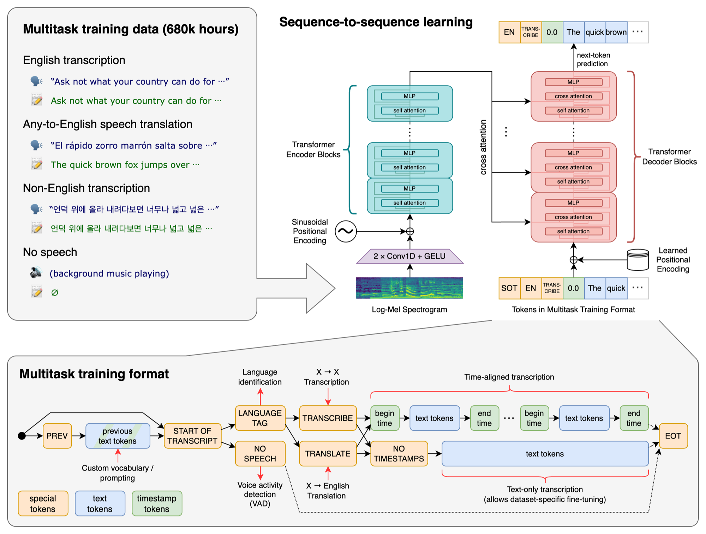
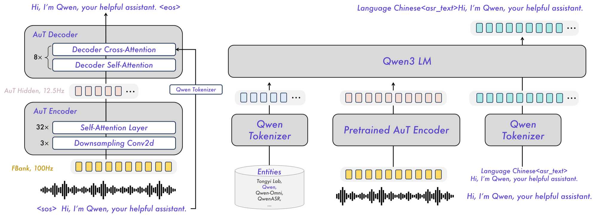
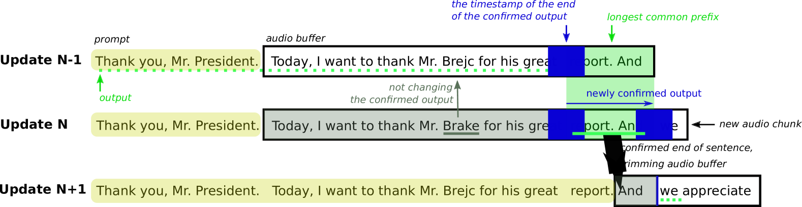
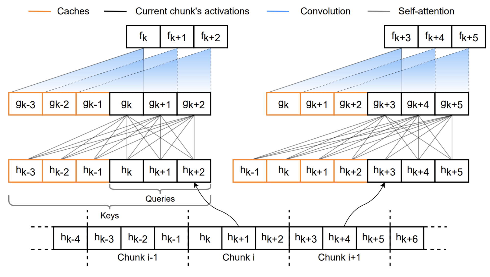
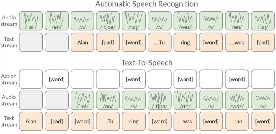
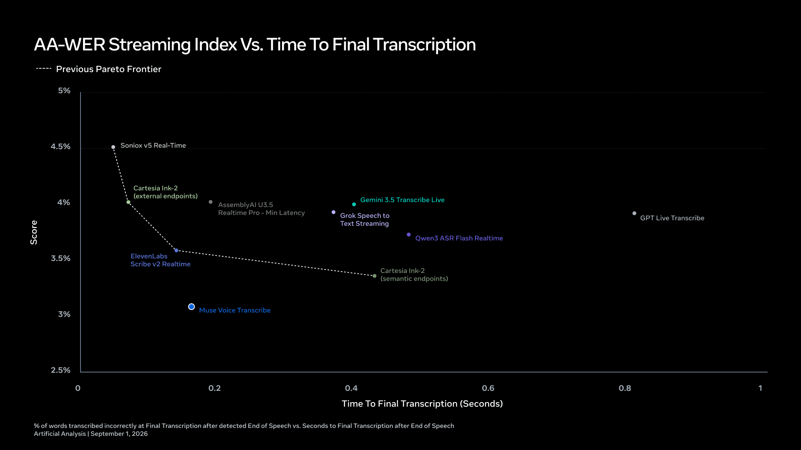
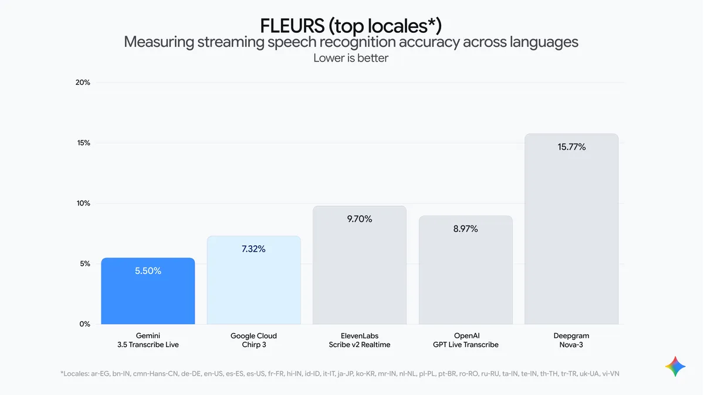
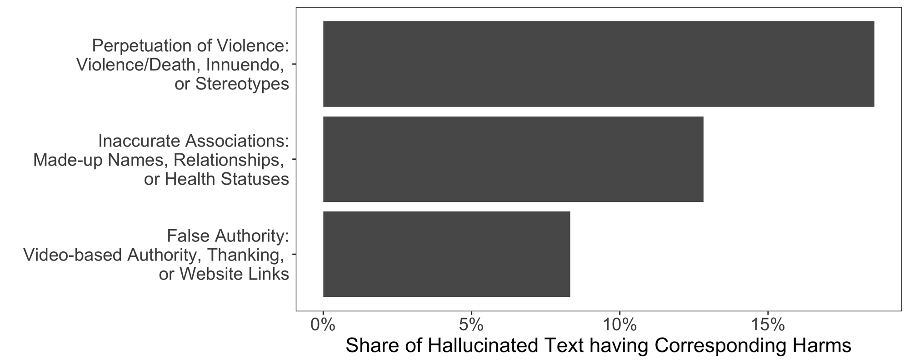

# At The Frontier: Speech to Text — History & Internals (research pack A)

Compiled 2026-11-03. Sources are linked inline. Conventions:
- **[verified]** means I checked it this session against the primary source linked (paper, model card, vendor docs or vendor blog).
- **[unverified]** means it came from secondary sources (press, Wikipedia, aggregators, rival vendors), or I couldn't reach the primary.
- **[calc]** is my own arithmetic or a reading off a chart. Treat it as approximate.
- Vendor accuracy numbers are **self-reported** unless stated otherwise. Latency and diarisation metrics are covered in other packs; this pack only touches them where they explain how models work.

A live example of access problems, from compiling this pack: `apnews.com` returned a Cloudflare "Just a moment..." challenge to curl, so the AP story below was read via a syndicated copy. OpenAI's developer docs, by contrast, publish clean markdown (`.md` suffix on any docs URL), which made the OpenAI facts easy to verify.

## Executive summary

1. **Seventy years, four recipes.** Template matching (Audrey 1952, Shoebox 1961) → statistical hidden Markov models (IBM/Jelinek and Dragon/Baker, 1970s–2011) → deep neural networks inside the HMM (2012) → end-to-end neural models (CTC 2006, RNN-T 2012, attention 2015, Conformer 2020) → large weakly-supervised and LLM-based models (Whisper 2022 onward). Each step removed a hand-built component.
2. **Every modern system is "encoder + decoder".** Audio is sampled (16 kHz for wideband, **8 kHz for phone calls**), turned into a log-mel spectrogram (25 ms windows every 10 ms), compressed by an encoder to one vector every 40–80 ms, then decoded to text. The **decoder family** decides most of the practical trade-offs: CTC (fastest, no hallucination of fluent text, weak on context), transducer/RNN-T/TDT (natively streaming, the workhorse of real-time), attention encoder-decoder (Whisper: most accurate offline, can hallucinate), and **speech-LLMs** (audio encoder + LLM decoder: promptable, context-aware, slowest, most hallucination-prone).
3. **Whisper (21 Sep 2022, 680,000 hours of weakly-labelled web audio) reset the field** and is now being retired as an API: OpenAI deprecated `whisper-1`, `gpt-4o-transcribe` and `gpt-4o-mini-transcribe` on 26 Aug 2026, with **shutdown on 26 Feb 2027**. The replacements are **GPT-Transcribe** (batch, $0.0045/min) and **GPT-Live-Transcribe** (streaming, $0.017/min), released 28 Jul 2026 [verified]. The open weights live on: `whisper-large-v3-turbo` shows ~5.6M monthly downloads on Hugging Face vs ~1.6M for Qwen3-ASR-1.7B [verified, HF API, 3 Nov 2026].
4. **Whisper is not a streaming model.** It reads fixed 30-second windows. People stream it by re-transcribing a growing buffer and only committing words that two passes agree on ("LocalAgreement"), at ~3.3 s latency. Purpose-built streaming models instead use **cache-aware encoders** (NVIDIA: 80 ms chunks, reusing past computation) or **delayed text streams** (Kyutai, Mistral Voxtral Realtime, Meta Muse) where the model learns how far behind the audio to write.
5. **2026 was the year big platforms built their own STT.** In one quarter: Gemini 3.5 Transcribe (26 Aug), Meta Muse Voice Transcribe (1 Sep), Microsoft MAI-Transcribe-2 (3 Sep), OpenAI GPT-Transcribe (28 Jul), AssemblyAI Universal-3.5 Pro (7 Jul), NVIDIA Nemotron 3.5 Transcribe (28 Oct). Most new flagships are **speech-LLMs** that accept a text prompt, keywords and prior turns.
6. **Streaming costs accuracy, and the gap is now small.** Google reports 4.0% WER streaming vs 2.6% batch for the same model on Artificial Analysis [verified]. Mistral says its realtime model at 480 ms delay is within 1–2 WER points of offline [verified]. Meta claims 3.1% streaming WER at ~0.16 s to final, the best streaming score on Artificial Analysis as of 1 Sep 2026 [verified as Meta's claim].
7. **Post-processing is half the product.** VAD (e.g. Silero: <1 ms per 30 ms chunk on one CPU thread), punctuation, inverse text normalisation ("twenty five dollars" → "$25"), word timestamps, confidence scores, keyterm prompting and PII redaction are what clients actually notice. LLM-based models fold several of these into the model, which is convenient but harder to audit.
8. **Hallucination is the signature failure of generative ASR.** "Careless Whisper" (FAccT 2024) found ~1% of Whisper API transcriptions contained entire invented phrases; 38% of those were harmful (violence, made-up names or health facts). The AP (26 Oct 2024) reported a Whisper-based clinical tool used for ~7 million medical visits that deletes the source audio. Silence and long pauses trigger it. CTC and transducer models rarely fabricate fluent sentences in silence, because they have no free-running language model.
9. **Bias is measured and large.** Koenecke et al. (PNAS, 2020): five commercial systems averaged **0.35 WER for Black speakers vs 0.19 for white speakers**; 23% vs 1.6% of snippets were "unusable" (WER > 0.5). Accents, telephony audio, overlapping speech, names, numbers and code-switching remain the hard cases. One vendor's 2026 code-switching test puts GPT-4o Transcribe at 44.6% WER vs 7.7% for the best model (vendor claim).
10. **WER is simple and easy to game.** WER = (substitutions + deletions + insertions) ÷ reference words. In my worked example the same transcript scores **77.8%, 55.6% or 14.3%** depending only on normalisation (case, punctuation, "$25" vs "twenty five dollars"). Use CER for Chinese, Japanese and Thai. Human professional transcribers score **5.1–5.9% on Switchboard and 6.8–11.3% on CallHome**; the oft-quoted "4%" rests on a personal communication.
11. **Speed is measured as RTFx** (seconds of audio per second of compute). The 2025 Open ASR Leaderboard paper found Conformer encoders with transformer decoders most accurate, and CTC/TDT decoders fastest. NVIDIA's Nemotron 3.5 Transcribe NIM claims up to 2,238 seconds of audio per second on one GPU.
12. **Speech-to-speech is real but most enterprises still cascade.** OpenAI GPT-Live (GA 10 Sep 2026, $0.05/min), gpt-realtime-2 (7 May 2026), Gemini Live native audio and Kyutai's Moshi (160 ms theoretical latency) skip the transcript. Enterprises keep STT → LLM → TTS because the transcript is the audit record, the control point for tools and guardrails, and the cheapest place to swap vendors. OpenAI's own docs describe the "chained" pipeline as the option for "control over each speech and text stage".

---

## 0. The one-slide mental model

Three ways to put speech recognition into a product:

| Mode | What it does | Typical use | Latency budget | Typical architecture (2026) | Main risk |
|---|---|---|---|---|---|
| **Batch / pre-recorded** | Upload a file, get back a finished transcript with timestamps, speakers, formatting | Call analytics, meeting notes, media subtitles, medical scribing after the visit | Minutes are fine | Attention encoder-decoder (Whisper-style) or speech-LLM; CTC/TDT for cheap bulk | Hallucination on silence; normalisation choices |
| **Streaming / real-time** | Audio goes in over a WebSocket; partial words come back within ~100–500 ms, then "final" text per phrase | Contact-centre agent assist, live captions, voice agents (STT → LLM → TTS) | 100–300 ms per word; end-of-turn detection matters more than WER | Transducer (RNN-T/TDT) with cache-aware encoder; delayed-stream decoder-only models; streaming speech-LLMs | Partials that change; accuracy loss vs batch; turn-taking |
| **Speech-to-speech** | No text in the loop (or text kept internal); audio in, audio out | Consumer voice assistants, companion apps, some voice agents | ~200–800 ms voice-to-voice | One multimodal model (gpt-realtime, GPT-Live, Gemini Live, Moshi) | No authoritative transcript; harder to audit and control |

The arc from 1952 to 2026: **match a stored template** → **model probabilities with HMMs** → **let neural networks learn the acoustics** → **let one network learn everything end-to-end** → **train on the whole internet with weak labels** → **bolt an audio encoder onto an LLM and prompt it**.

---

## 1. Timeline, 1952–2026

### 1.1 Before deep learning (1952–2011)

| Date | Event | Why it matters | Status |
|---|---|---|---|
| **1952** | Bell Labs **"Audrey"** (Automatic Digit Recognizer). K. H. Davis, R. Biddulph, S. Balashek, "Automatic Recognition of Spoken Digits", *JASA* 24(6): 637–642. Recognised the ten digits from one speaker who paused between words. | The first working recogniser: compare measured sound patterns with stored templates. Accuracy of "97–99%" for its trained speaker is widely repeated. | Citation [unverified, BibSonomy record]; accuracy figure [unverified, secondary] |
| **1961** | IBM **Shoebox**, by William C. Dersch, unveiled at a press conference: digits 0–9 plus six command words ("plus", "minus", "total", "subtotal"…). Shown at the 1962 Seattle World's Fair. Needed only 31 transistors. | A voice-driven calculator: 16 words. | [verified, IBM history](https://www.ibm.com/history/voice-recognition) |
| **1971–76** | DARPA Speech Understanding Research programme. CMU's **Harpy** recognised 1,011 words. | First large-vocabulary target; search over a network of word paths. | [unverified, Wikipedia timeline / PCWorld] |
| **Early 1970s →** | IBM's Continuous Speech Recognition Group (Watson Research Center), led by **Frederick Jelinek**, takes a statistical approach. Jelinek (1987): "We thought it was wrong to ask a machine to emulate people." | The birth of the **statistical / HMM paradigm**: acoustic model × language model, decoded by search. | [verified, IBM history](https://www.ibm.com/history/voice-recognition) |
| **1970s–80s** | **James and Janet Baker** apply hidden Markov models at CMU (the DRAGON system), then found **Dragon Systems in 1982**. IBM's **Tangora** targets a 20,000-word vocabulary by the mid-1980s. | HMMs become the 30-year industry standard (HMM states with Gaussian mixture models, "GMM-HMM"). | [unverified, Wikipedia / ETHW] |
| **1988–1993** | CMU **Sphinx** (Kai-Fu Lee): first speaker-independent continuous recogniser; **Sphinx-II** (Xuedong Huang, 1993). | Open research systems; Huang later led Microsoft's speech group. | [unverified, Wikipedia timeline] |
| **1990** | **Dragon Dictate**, the first consumer dictation product (discrete words, pause between each). | | [unverified] |
| **1997** | **Dragon NaturallySpeaking 1.0**: first general-purpose *continuous* dictation product for PCs. Wikipedia gives April or June 1997 in different places. Dragon later went to Lernout & Hauspie (2000), ScanSoft, then Nuance (merged 2005). | Consumer dictation becomes real on ordinary PCs. | [unverified, Wikipedia] |
| **2006** | **CTC**: Graves, Fernández, Gomez, Schmidhuber, "Connectionist Temporal Classification: Labelling Unsegmented Sequence Data with Recurrent Neural Networks", ICML 2006 (IDSIA). | Lets a neural network learn from audio + transcript pairs **without** knowing which frame belongs to which letter. The foundation of end-to-end ASR. | [verified, PDF](https://www.cs.toronto.edu/~graves/icml_2006.pdf) |
| **2007** | Google **GOOG-411** phone directory service, used partly to collect voice data. | | [unverified] |
| **14 Nov 2008** | **Google Voice Search** app for iPhone. | Speech recognition moves to the cloud and to phones. | [unverified, NYT via Wikipedia] |
| **4 Oct 2011** | Apple announces **Siri** with the iPhone 4S (recognition originally from Nuance). | Voice assistants go mainstream. | [unverified] |

### 1.2 The deep-learning decade (2012–2021)

| Date | Event | Why it matters | Status |
|---|---|---|---|
| **Nov 2012** | Hinton, Deng, Yu, Dahl et al., "Deep Neural Networks for Acoustic Modeling in Speech Recognition: The Shared Views of Four Research Groups", *IEEE Signal Processing Magazine* 29(6): 82–97. Toronto, Microsoft Research, Google and IBM agree DNNs beat GMMs "sometimes by a large margin". | The **DNN-HMM hybrid**: keep the HMM, replace the Gaussian mixtures with a neural net. Google says DNNs replaced "the 30-year old standard" GMM in its products in 2012. | Paper [unverified, Google Research / MSR records]; Google 2012 switch [verified, Google blog 2015](https://research.google/blog/google-voice-search-faster-and-more-accurate/) |
| **14 Nov 2012** | **RNN-Transducer**: Graves, "Sequence Transduction with Recurrent Neural Networks" ([arXiv 1211.3711](https://arxiv.org/abs/1211.3711)). | Adds a "prediction network" (a small language model over previous outputs) to CTC. Becomes the standard architecture for on-device and streaming ASR. | [verified] |
| **22 Mar 2013** | Graves, Mohamed, Hinton, "Speech Recognition with Deep Recurrent Neural Networks" ([arXiv 1303.5778](https://arxiv.org/abs/1303.5778)): deep LSTMs + CTC. | | [verified] |
| **17 Dec 2014** | **Deep Speech** (Baidu, Hannun et al., [arXiv 1412.5567](https://arxiv.org/abs/1412.5567)): "We do not need a phoneme dictionary, nor even the concept of a 'phoneme.'" | End-to-end RNN + CTC trained on lots of (partly synthetic) data, competitive on Switchboard. Proof that scale + simple architecture works. | [verified] |
| **5 Aug 2015** | **Listen, Attend and Spell** (Google, Chan, Jaitly, Le, Vinyals, [arXiv 1508.01211](https://arxiv.org/abs/1508.01211)): pyramidal RNN "listener" + attention "speller". 14.1% WER (10.3% with LM rescoring) vs 8.0% for the production CLDNN-HMM on a voice-search subset. | The first **attention encoder-decoder** for speech. Not yet better than the hybrid, but the template for Whisper. | [verified] |
| **24 Sep 2015** | Google voice search moves to **CTC-trained LSTM** acoustic models: faster, more robust in noise. An early version delayed outputs by ~300 ms until retrained. | First large-scale production use of CTC. | [verified, Google Research blog](https://research.google/blog/google-voice-search-faster-and-more-accurate/) |
| **17 Oct 2016** | Microsoft, "Achieving Human Parity in Conversational Speech Recognition" ([arXiv 1610.05256](https://arxiv.org/abs/1610.05256)). Professional transcribers measured at **5.9% (Switchboard) and 11.3% (CallHome)**. The system reached 5.8% and 11.0% (v2 of the paper; the October 2016 announcement said 5.9%). | The "human parity" headline. | [verified] |
| **6 Mar 2017** | IBM (Saon et al., [arXiv 1703.02136](https://arxiv.org/abs/1703.02136)) re-measures humans: **5.1% Switchboard, 6.8% CallHome** for the best transcriber after quality checks, and reports 5.5%/10.3% for its own system. "Human performance may be considerably better than what was earlier reported." | The goalposts move. | [verified, paper PDF] |
| **21 Aug 2017** | Microsoft 2017 system reaches **5.1% on Switchboard** ([arXiv 1708.06073](https://arxiv.org/abs/1708.06073)), matching IBM's human figure. | | [verified] |
| **Jun 2017** | Transformer ("Attention Is All You Need") — later adopted for speech encoders and decoders. | | [general knowledge] |
| **7 Aug 2018** | **Contextual LAS (CLAS)** (Google, [arXiv 1808.02480](https://arxiv.org/abs/1808.02480)): feed a list of context phrases into the model, up to 68% relative WER reduction vs shallow fusion. | The research root of today's "keyterm prompting" and contextual biasing. | [verified] |
| **16 May 2020** | **Conformer** (Google, Gulati et al., [arXiv 2005.08100](https://arxiv.org/abs/2005.08100)): convolution (local patterns) + self-attention (global context) in each block. LibriSpeech 2.1%/4.3% without LM, 1.9%/3.9% with. | Became the dominant ASR encoder. NVIDIA's Parakeet/Canary/Nemotron, Google's USM and most production streaming models use Conformer variants. | [verified] |
| **20 Jun 2020** | **wav2vec 2.0** (Facebook AI, Baevski et al., [arXiv 2006.11477](https://arxiv.org/abs/2006.11477)): self-supervised pre-training on unlabelled audio, then fine-tune. With **10 minutes** of labelled data (plus 53k hours unlabelled), 4.8/8.2 WER on LibriSpeech. | Unlabelled audio becomes useful. Enables low-resource languages (MMS, Omnilingual ASR). | [verified] |
| **2021** | **NeMo Inverse Text Normalization** (NVIDIA, [arXiv 2104.05055](https://arxiv.org/abs/2104.05055)): open-source WFST grammars to turn spoken-form ASR output into written form. | Shows ITN is still rule-based in most production stacks because "this task has extremely low tolerance to unrecoverable errors". | [verified] |

### 1.3 The foundation-model era (2022–2024)

| Date | Event | Why it matters | Status |
|---|---|---|---|
| **21 Sep 2022** | OpenAI **Whisper** released (open weights, MIT). Paper "Robust Speech Recognition via Large-Scale Weak Supervision" ([arXiv 2212.04356](https://arxiv.org/abs/2212.04356), 6 Dec 2022). **680,000 hours** of audio paired with internet transcripts, of which 117,000 hours cover 96 non-English languages and 125,000 hours are X→English translation. Sizes from tiny (39M) to large (1,550M). | Trained to predict ordinary written transcripts (punctuation, casing, numbers), so it needed **no separate inverse text normalisation**. Zero-shot robustness across accents and domains, "close to human-level accuracy" on English. | Paper facts [verified]; release month [verified, model card](https://github.com/openai/whisper/blob/main/model-card.md); 21 Sep per OpenAI's (translated) announcement page via search; some outlets say 22 Sep [unverified] |
| **Dec 2022** | Whisper **large-v2**. | | [verified, model card] |
| **2 Mar 2023** | Google **USM** (Universal Speech Model, [arXiv 2303.01037](https://arxiv.org/abs/2303.01037)): encoder pre-trained on **12M hours** across 300+ languages, fine-tuned for 100+ languages; labelled set 1/7th the size of Whisper's. Basis of Google Cloud's **Chirp** models. | Self-supervised scale beats weak labels on many languages. | Paper [verified]; Chirp link [unverified] |
| **22 May 2023** | Meta **MMS** (Massively Multilingual Speech, [arXiv 2305.13516](https://arxiv.org/abs/2305.13516)): wav2vec 2.0 models for 1,406 languages, one ASR model for **1,107 languages**, language ID for 4,017. Data largely from readings of religious texts. | Coverage 10–40x previous systems. | [verified] |
| **27 Jul 2023** | **Whisper-Streaming** (Macháček, Dabre, Bojar, [arXiv 2307.14743](https://arxiv.org/abs/2307.14743)): LocalAgreement policy, **3.3 s latency** on long-form speech. | The standard recipe for streaming a non-streaming model (§2.5). | [verified] |
| **13 Apr 2023** | **TDT** (Token-and-Duration Transducer, NVIDIA, [arXiv 2304.06795](https://arxiv.org/abs/2304.06795)): predicts each token *and how many frames to skip*. Up to 2.82x faster inference than RNN-T with better accuracy. | Powers NVIDIA's Parakeet-TDT models, top of the speed rankings. | [verified] |
| **8 May 2023** | **Fast Conformer** (NVIDIA, [arXiv 2305.05084](https://arxiv.org/abs/2305.05084)): 8x downsampling to one frame per **80 ms**, 2.8x faster than Conformer, handles up to 11 hours with local attention. | The encoder behind Parakeet, Canary and Nemotron Speech. | [verified] |
| **6 Nov 2023** | Whisper **large-v3** (DevDay). Uses 128 mel bins instead of 80. | | Release [verified, GitHub v20231106]; 128 mels [verified, changelog]; training-data size [unverified] |
| **27 Dec 2023** | **Cache-aware streaming FastConformer** (NVIDIA, Noroozi et al., [arXiv 2312.17279](https://arxiv.org/abs/2312.17279)): limit look-ahead and cache encoder activations so a non-autoregressive encoder runs chunk by chunk. | The architecture behind NVIDIA's 2026 Nemotron streaming models (§2.5). | [verified] |
| **Dec 2023–Feb 2024** | NVIDIA **Parakeet** (RNN-T, TDT, CTC 0.6B/1.1B; with Suno.ai) and **Canary-1B** (multilingual, AED) appear on Hugging Face. | Open models top the Hugging Face Open ASR Leaderboard. | HF repo dates 27 Dec 2023 / 25 Jan / 7 Feb 2024 [verified, HF API] |
| **12 Feb 2024** | **"Careless Whisper"** preprint ([arXiv 2402.08021](https://arxiv.org/abs/2402.08021)); published at ACM FAccT, 3–6 Jun 2024. | The hallucination study (§4.1). | [verified] |
| **2024** | Google Gemini 1.5 accepts audio input natively; LLMs start doing transcription as one task among many. | The speech-LLM idea reaches the mass market. | [unverified] |
| **17 Sep 2024** | Kyutai **Moshi** ([arXiv 2410.00037](https://arxiv.org/abs/2410.00037)): first real-time full-duplex spoken LLM, "theoretical latency of 160ms, 200ms in practice". | Speech-to-speech in open weights. Its "inner monologue" text stream also does streaming ASR. | [verified] |
| **30 Sep–1 Oct 2024** | Whisper **large-v3-turbo**: decoder cut down, 809M params (README; model card says 798M), ~8x faster than large. | The default self-hosted Whisper since. | [verified, GitHub v20240930, HF repo 1 Oct 2024] |
| **26 Oct 2024** | **AP investigation**: Whisper invents text, including in medical transcription (§4.1). | Hallucination becomes a board-level risk. | [verified via syndicated copy] |

### 1.4 2025

| Date | Event | Status |
|---|---|---|
| **20 Jan 2025** | "Investigation of Whisper ASR Hallucinations Induced by Non-Speech Audio" ([arXiv 2501.11378](https://arxiv.org/abs/2501.11378), ICASSP 2025): a recurring "bag of hallucinations" phrases; removing them by post-processing lowers WER. | [verified] |
| **12 Feb 2025** | **Deepgram Nova-3**, with self-serve **keyterm prompting** (up to 100 terms at launch, no retraining). | [unverified, Deepgram changelog via search] |
| **24 Feb 2025** | Microsoft **Phi-4-multimodal** (speech + vision + text LLM) tops the Open ASR Leaderboard for a time. | HF repo date [verified]; ranking [unverified] |
| **20 Mar 2025** | **gpt-4o-transcribe** and **gpt-4o-mini-transcribe** added to OpenAI's Audio API — the first OpenAI transcription models built on an LLM. | [verified, OpenAI changelog](https://developers.openai.com/api/docs/changelog) |
| **Apr 2025** | IBM **Granite Speech 3.3** (Apache 2.0); NVIDIA **Parakeet-TDT-0.6B-v2** (English; repo 15 Apr). | [verified, HF API dates] |
| **6 Jun 2025** | **Kyutai STT** (1B en/fr with 0.5 s delay; 2.6B en with 2.5 s delay), built on delayed streams modelling. | [verified, HF model card](https://huggingface.co/kyutai/stt-2.6b-en) |
| **9 Jun 2025** | Apple **SpeechAnalyzer / SpeechTranscriber** (WWDC25, iOS 26 / macOS Tahoe): new on-device model for long-form and distant audio, replacing the short-dictation `SFSpeechRecognizer` path. No WER published at launch. | [unverified, WWDC session pages and press] |
| **26 Jun 2025** | NVIDIA **Canary-Qwen-2.5B** (FastConformer encoder + Qwen LLM decoder, "SALM"), English. Tops the Open ASR Leaderboard. | Repo date [verified, HF]; ranking [unverified] |
| **15–17 Jul 2025** | Mistral **Voxtral** Mini (3B) and Small (24B), Apache 2.0 ([arXiv 2507.13264](https://arxiv.org/abs/2507.13264)): Whisper large-v3 encoder → adapter (4x downsampling to 12.5 Hz) → Mistral LLM; 32k context ≈ 40 minutes of audio. | [verified] |
| **4 Aug 2025** | NVIDIA **Parakeet-TDT-0.6B-v3** (25 European languages) and **Canary-1B-v2**, CC-BY-4.0. | [verified, HF API dates] |
| **28 Aug 2025** | OpenAI Realtime API generally available; **gpt-realtime** speech-to-speech model. | [verified, OpenAI changelog] |
| **Sep 2025** | Kyutai **Delayed Streams Modeling** paper ([arXiv 2509.08753](https://arxiv.org/abs/2509.08753)); Alibaba **Qwen3-ASR-Flash** API. | DSM [verified]; Qwen3-ASR-Flash [unverified] |
| **2 Oct 2025** | **Deepgram Flux**: "conversational speech recognition" with end-of-turn detection built into the model. | [unverified, press release; see pack D] |
| **8 Oct 2025** | **Open ASR Leaderboard** paper (Hugging Face et al., [arXiv 2510.06961](https://arxiv.org/abs/2510.06961)): 86 systems, 12 datasets; Conformer + transformer decoders most accurate, CTC/TDT fastest. | [verified] |
| **10–12 Nov 2025** | Meta **Omnilingual ASR** ([arXiv 2511.09690](https://arxiv.org/abs/2511.09690)): **1,600+ languages, 500+ never served before**; 7B wav2vec-style encoder with an LLM-inspired decoder; new languages from "a handful of data samples" in context. Apache 2.0. | [verified] |
| **13 Nov 2025** | ElevenLabs **Scribe v2 Realtime** ("30–80ms"). | [verified as vendor claim, ElevenLabs blog](https://elevenlabs.io/blog/scribe-v2-realtime-in-elevenlabs-agents) |
| **15 Dec 2025** | OpenAI **gpt-4o-mini-transcribe-2025-12-15** snapshot; from 13 Jan 2026 OpenAI recommended it over `gpt-4o-transcribe` "for the best results". | [verified, OpenAI changelog] |
| **17 Dec 2025** | NVIDIA **nemotron-speech-streaming-en-0.6b** repo (cache-aware FastConformer-RNNT; public 5 Jan 2026). | [verified, HF] |

### 1.5 2026, month by month

| Date | Event | Status |
|---|---|---|
| **5 Jan 2026** | NVIDIA Nemotron ASR Streaming (English, 600M, cache-aware RNN-T), updated checkpoint **13 Mar 2026** trained on ~250,000 hours. Chunk sizes 80/160/560/1,120 ms selectable at run time. | [verified, model card](https://huggingface.co/nvidia/nemotron-speech-streaming-en-0.6b) |
| **Jan 2026** | ElevenLabs **Scribe v2** (batch). | [unverified, secondary] |
| **29 Jan 2026** | **Qwen3-ASR** technical report and open weights (1.7B and 0.6B, Apache 2.0; [arXiv 2601.21337](https://arxiv.org/abs/2601.21337)): 52 languages and dialects; built on Qwen3-Omni; "AuT" attention encoder-decoder encoder at 12.5 Hz feeding a Qwen3 LLM; dynamic attention window 1–8 s for unified streaming/offline; 0.6B model "TTFT as low as 92ms". Plus **Qwen3-ForcedAligner-0.6B** for timestamps. | [verified] |
| **3 Feb 2026** | AssemblyAI **Universal-3 Pro**, "a first of its kind promptable speech language model". | [unverified, AssemblyAI blog via search] |
| **4 Feb 2026** | Mistral **Voxtral Transcribe 2**: Voxtral Mini Transcribe V2 (batch, $0.003/min, ~4% FLEURS WER) and **Voxtral Realtime** (open weights, Apache 2.0, ~4B, delay "configurable down to sub-200ms", $0.006/min). | [verified, Mistral](https://mistral.ai/news/voxtral-transcribe-2) |
| **23 Feb 2026** | OpenAI **gpt-realtime-1.5** (speech-to-speech). | [verified, OpenAI changelog] |
| **Mar 2026** | xAI **Grok Speech to Text** API (beta). Gemini **3.1 Flash Live** (audio-to-audio). | [unverified, secondary] |
| **24 Mar 2026** | **Cohere Transcribe** (2B, Apache 2.0, 14 languages); reported #1 on the Open ASR Leaderboard at launch (5.42% average WER). | Repo/licence/languages [verified, HF API]; ranking [unverified] |
| **2 Apr 2026** | Microsoft **MAI-Transcribe-1** (25 languages, Foundry public preview). | [unverified, press] |
| **29 Apr 2026** | **Deepgram Flux Multilingual** GA (10 languages). | [unverified, Business Wire syndication] |
| **7 May 2026** | OpenAI **gpt-realtime-2** (speech-to-speech with configurable reasoning), **gpt-realtime-translate**, and **gpt-realtime-whisper** (streaming STT, $0.017/min). | [verified, OpenAI changelog](https://developers.openai.com/api/docs/changelog) |
| **4 Jun 2026** | NVIDIA **Nemotron 3.5 ASR Streaming 0.6B**: 40 language-locales in one 600M streaming model. | [verified, note on Nemotron model card] |
| **6 Jul 2026** | OpenAI **gpt-realtime-2.1** and **2.1-mini** ("improved alphanumeric recognition, silence and noise handling"). | [verified, OpenAI changelog] |
| **7 Jul 2026** | AssemblyAI **Universal-3.5 Pro** (18 languages, native code-switching, joint transcript + diarisation, $0.21/hr) and Universal-3.5 Pro Realtime. | [verified, AssemblyAI blog](https://www.assemblyai.com/blog/universal-3-5-pro-async) |
| **20 Jul 2026** | OpenAI deprecates legacy realtime/audio models (`gpt-realtime`, `gpt-4o-realtime`…) for shutdown **20 Jan 2027**. | [verified, OpenAI deprecations](https://developers.openai.com/api/docs/deprecations) |
| **28 Jul 2026** | OpenAI **GPT-Transcribe** ($0.0045/min, file + committed realtime turns) and **GPT-Live-Transcribe** ($0.017/min, low-latency deltas, "tunable latency"). Both take free-form context, keyword hints and multiple language hints. OpenAI's own numbers for Live: 19.70% error on Common Voice (22 languages) vs 20.33% for gpt-realtime-whisper; 9.60% vs 11.65% on its "Real-World Audio Recording" benchmark; semantic accuracy 38.5% → 44.6% with context on a new "Context Aware ASR" benchmark. | [verified, OpenAI changelog, model pages, community post 29 Jul](https://community.openai.com/t/gpt-live-transcribe-and-gpt-transcribe-two-new-transcription-models-in-the-api/1388318) |
| **26 Aug 2026** | OpenAI announces shutdown of **`whisper-1`, `gpt-4o-transcribe`, `gpt-4o-mini-transcribe`, `gpt-4o-transcribe-diarize`** and `/v1/audio/translations` on **26 Feb 2027**. Note: word timestamps, SRT/VTT and diarised output are still documented only on the deprecated models. | [verified, OpenAI deprecations + transcription guide](https://developers.openai.com/api/docs/guides/transcription) |
| **26 Aug 2026** | Google **Gemini 3.5 Transcribe** (`gemini-3.5-transcribe`, and `gemini-3.5-transcribe-live` on the Live API), public preview: 85+ languages, filler removal and auto-formatting, custom vocabulary, function calling. AA-WER 4.0% streaming / 2.6% batch; FLEURS top locales 5.50% / 5.04%. "Time to final transcription improves by 70%" vs Chirp 3. Price not on the blog; The Batch reports ~$0.005/min batch, ~$0.009/min streaming. | Facts [verified, Google blog](https://blog.google/innovation-and-ai/models-and-research/gemini-models/gemini-3-5-transcribe/); price [unverified, The Batch] |
| **1 Sep 2026** | Meta **Muse Voice Transcribe** (Meta Superintelligence Labs): streaming, 80 ms chunks → one "soft token" each; the model emits text or `<|next_audio|>` at each step; **adaptive delay** trained by RL with a WER × delay reward; joint diarisation and endpointing tokens; 70+ languages (25 "extensively verified"); 1 h+ audio, 20+ speakers. Claims 3.1% streaming WER, #1 on Artificial Analysis streaming. | [verified, Meta](https://research.meta.ai/blog/introducing-muse-voice-transcribe); price $0.18/hr [unverified, The Batch] |
| **3 Sep 2026** | Microsoft **MAI-Transcribe-2**: 60 languages, 5.2% average WER on FLEURS (claimed #1), #2 on Artificial Analysis, "up to 10x faster" than leading competitors; **$0.10 per audio hour** launch price to year end. No architecture disclosed. | [verified, microsoft.ai](https://microsoft.ai/news/mai-transcribe-2-is-the-fastest-most-accurate-and-cheapest-speech-recognition-model-in-the-world/) |
| **10 Sep 2026** | OpenAI **GPT-Live 1** GA: full-duplex voice that delegates reasoning and tools to a separate backend model; $0.05/min. | [verified, OpenAI changelog] |
| **18 Sep 2026** | xAI **Grok Voice Transcribe 2.0** ($0.10/hr batch, "twice as accurate as version 1.0"). | [unverified, Unite.AI] |
| **29 Sep 2026** | AssemblyAI **Universal-3.6 Pro Realtime** ($0.45/hr). | [unverified, trackers and integration docs] |
| **28 Oct 2026** | NVIDIA **Nemotron 3.5 Transcribe 30B-A4B**: open-weight offline speech-LLM. 600M transformer ASR encoder + Sortformer diarisation encoder → hybrid Mamba-Transformer MoE LLM (~4.3B active of 30B), CTC head for word timestamps, 40 languages, 1-hour recordings. Claims best open-weight Open ASR Leaderboard mean WER **4.71%** (vs Qwen3-ASR-1.7B 4.94%), long-form 10.98%, multilingual 4.62%. Licence: OpenMDW-1.1. | [verified, HF model card](https://huggingface.co/nvidia/NVIDIA-Nemotron-3.5-Transcribe-30B-A4B) |

### 1.6 What the timeline teaches

- **Each era removed a hand-built part.** Templates → HMMs removed hand-tuned matching; DNNs removed hand-designed acoustic features (mostly); CTC/RNN-T/attention removed the pronunciation dictionary and HMM; Whisper removed the separate ITN and punctuation steps; speech-LLMs are removing separate diarisation, formatting and vocabulary-biasing modules.
- **Data beat architecture twice.** wav2vec 2.0 (unlabelled audio) and Whisper (weakly-labelled internet audio) both won by changing the data recipe, not the network.
- **Benchmarks saturate, so marketing moves to new ones.** Switchboard "human parity" (2016–17) → LibriSpeech below 2% → FLEURS and Artificial Analysis AA-WER (2025–26) → "context-aware" and "semantic accuracy" benchmarks invented by vendors (OpenAI, Jul 2026).
- **The 2026 pattern:** every platform (Google, Meta, Microsoft, OpenAI, xAI, NVIDIA) now ships its own transcription model, priced from **$0.10/hr (Microsoft promo, xAI) to ~$1/hr (OpenAI Live at $0.017/min)** [calc]. Specialists (Deepgram, AssemblyAI, ElevenLabs, Soniox, Speechmatics, Cartesia) compete on streaming latency, turn detection, diarisation and contact-centre features.

---

## 2. How speech recognition works (for a non-engineer)

### 2.1 From air pressure to numbers: sampling

- A microphone measures air pressure; the computer stores it as a list of numbers, the **waveform**.
- **Sample rate** = how many numbers per second. You can only capture frequencies up to half the sample rate (the Nyquist limit).
  - **16 kHz** (16,000 samples/s, captures up to 8 kHz) is the standard for ASR. Whisper "re-sampled [all audio] to 16,000 Hz" [verified, Whisper paper]. Nemotron 3.5 Transcribe also takes 16 kHz [verified, architecture figure].
  - **8 kHz telephony** (captures only up to ~4 kHz, "narrowband"). Twilio Media Streams always deliver `audio/x-mulaw` at **8000 Hz**, mono, base64 [verified, Twilio docs](https://www.twilio.com/docs/voice/media-streams/websocket-messages). μ-law also compresses each sample to 8 bits.
  - Why it matters: phone audio throws away the high frequencies that distinguish "s"/"f"/"th", and adds codec artefacts. Models must be up-sampled to 16 kHz (which adds no information) or trained on 8 kHz data. **Contact-centre accuracy should always be tested on real 8 kHz call audio**, not on vendor benchmarks recorded at 16 kHz or higher.
- **Teaching point:** 1 minute of 16 kHz 16-bit mono audio = 1.92 MB raw [calc: 16,000 × 2 bytes × 60]. 8 kHz μ-law = 0.48 MB [calc].

### 2.2 The spectrogram: a picture of sound

- The model doesn't look at raw samples. It cuts the audio into short overlapping windows and measures how much energy is at each frequency.
- Whisper: "an 80-channel log-magnitude Mel spectrogram representation is computed on 25-millisecond windows with a stride of 10 milliseconds" [verified, Whisper paper]. So **100 frames per second**, each a column of 80 numbers (128 for Whisper large-v3 and Nemotron 3.5 Transcribe [verified]).
- **Mel** spacing: more resolution at low frequencies, like the human ear. **Log**: loudness is perceived roughly logarithmically.
- Training usually adds **SpecAugment** (masking random time and frequency bands) so the model is robust to missing information.

### 2.3 The encoder: from 100 frames/s to a compact summary

- The **encoder** turns the spectrogram into a sequence of vectors that represent "what sounds are here, in context".
- It first **downsamples** with convolution: 4x (one vector every 40 ms, classic Conformer) or 8x (every 80 ms, NVIDIA Fast Conformer; Qwen3-ASR's AuT encoder at 12.5 Hz; Voxtral after its adapter; Meta Muse uses 80 ms chunks) [verified, papers/model cards]. Fewer vectors = faster and cheaper, especially for attention.
- Then a stack of **Conformer** blocks: feed-forward → self-attention (global context) → convolution (local patterns like a phoneme's shape) → feed-forward [verified, Conformer paper]. Whisper's encoder is a plain Transformer after two convolution layers [verified, Whisper paper].
- **Self-supervised pre-training** (wav2vec 2.0, Google's BEST-RQ for USM, Meta's Omnilingual 7B encoder) teaches the encoder on unlabelled audio first. This is why 2023–25 models could cover 1,000–1,600 languages.

### 2.4 The decoder: four families

The encoder says "what sounds"; the decoder turns that into words. The core problem is **alignment**: the audio has ~12–25 encoder vectors per second, a sentence has ~2–3 words per second, and nobody labelled which vector belongs to which letter.

| Family | How it decodes (plain English) | Examples | Speed | Streaming | Hallucination risk | Context / prompting |
|---|---|---|---|---|---|---|
| **CTC** (2006) | For every encoder frame, independently guess a token or "blank"; collapse repeats and blanks. No memory of what it already wrote. | wav2vec 2.0 fine-tunes, MMS, Omnilingual-CTC, Parakeet-CTC, Google voice search 2015 | **Fastest** (one parallel pass) | Yes, natively | **Low**: can't invent a fluent sentence in silence; errors look like misspellings | Weak; add an external LM or word boosting at decode time |
| **Transducer** (RNN-T 2012; TDT 2023) | Like CTC, but a small "prediction network" remembers the previous tokens and a "joint network" combines both. TDT also predicts how many frames to skip. | Google on-device ASR, Parakeet-TDT, Nemotron streaming (RNN-T), most production streaming engines | Fast (TDT up to 2.82x RNN-T) | **Yes — the default for real-time** | Low | Moderate (contextual biasing, keyword boosting) |
| **Attention encoder-decoder (AED)** (LAS 2015) | A text decoder writes the transcript word by word, "attending" to whichever part of the audio it needs. | Whisper, Canary, Qwen's AuT encoder pre-training | Slower (autoregressive), batches well | **No** — needs the whole window (Whisper: 30 s) | **Higher**: a language model can keep writing plausible text | Good (Whisper `initial_prompt`; task/language tokens) |
| **Speech-LLM** (audio encoder + LLM decoder) (2023→) | An audio encoder turns sound into "soft tokens" that are fed into a general LLM alongside a text prompt; the LLM writes the transcript (or a summary, or an answer). | gpt-4o-transcribe / GPT-Transcribe (inferred), Gemini, Voxtral, Qwen3-ASR, Canary-Qwen, Nemotron 3.5 Transcribe, Muse Voice Transcribe, AssemblyAI Universal-3 Pro ("promptable speech language model") | Slowest per stream; large models | Only with special training (delayed/adaptive streams, chunked attention) | **Highest** in principle; also may "clean up" or paraphrase | **Best**: free-form context, keyword lists, prior turns, style instructions |

Notes:
- The Open ASR Leaderboard paper's finding [verified]: "Conformer-based encoders paired with transformer-based decoders achieve the best average WER, while connectionist temporal classification (CTC) and token-and-duration transducer (TDT) decoders offer superior RTFx".
- **Hybrids are common.** NeMo trains a shared encoder with both CTC and RNN-T heads [verified, cache-aware paper]. Nemotron 3.5 Transcribe adds a CTC head to an LLM purely to get word timestamps [verified]. Qwen3-ASR uses a separate forced aligner for timestamps [verified].
- **OpenAI doesn't publish the architecture** of gpt-4o-transcribe or GPT-Transcribe; "speech-LLM" is inferred from the naming, the token-based context window (gpt-realtime-whisper lists a 16,000 context window and a Sep 2024 knowledge cutoff, [verified](https://developers.openai.com/api/docs/models/gpt-realtime-whisper)) and the free-form prompt input.
- Microsoft, Google and Meta disclosed no architecture for their Aug–Sep 2026 models except Meta's chunking description (The Batch, 11 Sep 2026) [verified].

**Why speech-LLMs won the 2026 flagships anyway:** they take **context**. OpenAI's new models accept a `prompt` (topic, setting), `keywords` (product names, medications) and `languages` (expected languages for code-switching) [verified, OpenAI transcription guide]. AssemblyAI reports prior-visit notes cut missed medical terms by 31% in an internal healthcare test [verified as vendor claim]. NVIDIA's Nemotron 3.5 Transcribe takes style instructions ("Preference-ASR": 7.56% → 6.16% WER when instructed) [verified as vendor claim].

### 2.5 Streaming: why it's hard and how it's done

**The problem.** A streaming model must emit words before it has heard the end of the sentence. Every millisecond of "look-ahead" improves accuracy and costs latency. Two kinds of output:
- **Partial (interim) results:** fast guesses that may change ("I'd like to book a…" → "I'd like to book a flight").
- **Final results:** committed text for a phrase, usually after an endpoint (silence or a model-predicted end of turn). Voice agents act on finals; captions show partials.

**Why Whisper isn't natively streaming.** It was trained on 30-second segments: "Whisper models are trained on 30-second audio chunks and cannot consume longer audio inputs at once" [verified, Whisper paper]. Its encoder attends over the whole window in both directions, and the decoder writes after seeing it all. Long files are handled by "buffered transcription": transcribe 30 s, shift the window by the predicted timestamps, repeat [verified].

**How people stream Whisper anyway (and other offline models):**
1. **Naive chunking:** cut audio into 1–5 s pieces and transcribe each. Words get cut at boundaries and context is lost.
2. **VAD segmentation:** cut at pauses detected by a VAD, so each chunk is a phrase. Good for captions; latency = phrase length.
3. **Re-transcribe a growing buffer + LocalAgreement** (Whisper-Streaming, 2023): every update, re-run on the whole unconfirmed buffer; commit only the prefix on which the last two runs agree; trim the buffer at confirmed sentence ends. Achieved **3.3 s** latency on long-form speech [verified]. Costly: the same audio is processed many times.

**Native streaming designs (2023–2026):**

| Design | Idea | Examples | Latency knobs |
|---|---|---|---|
| **Cache-aware encoder + RNN-T/TDT** | Train the encoder with limited look-ahead; at inference keep a cache of previous activations so each new 80 ms chunk only processes new audio. "Eliminates redundant overlapping computations common in traditional 'buffered' streaming". | NVIDIA Nemotron ASR Streaming (600M, en; 3.5 version 40 locales) | Chunk 80 / 160 / 560 / 1,120 ms chosen at run time, no retraining [verified] |
| **Delayed streams (decoder-only)** | Feed audio tokens and text tokens to one model as parallel streams, with the text stream shifted a fixed delay behind the audio. | Kyutai STT (0.5 s or 2.5 s delay), Moshi's inner monologue | Delay set at training (Kyutai) [verified] |
| **Configurable-delay streaming LLM** | Similar idea with a delay chosen at inference. | Mistral Voxtral Realtime: sub-200 ms to 2.4 s; at 2.4 s matches the batch model, at 480 ms within 1–2 WER points [verified] | Delay parameter |
| **Adaptive delay** | The model decides, word by word, whether to wait for more audio (`<|next_audio|>`) or write; trained with RL on WER × delay. | Meta Muse Voice Transcribe: ~3.0% error at ~0.16 s to final (Meta's chart of Artificial Analysis data) [verified as Meta claim] | Learned per word |
| **Chunked/dynamic attention in a speech-LLM** | Train with attention windows of varying length so one model does both streaming and offline. | Qwen3-ASR: 1–8 s window [verified]; GPT-Live-Transcribe "tunable latency" [verified, no mechanism disclosed] | Window/chunk size |
| **Recognition + turn-taking in one model** | The streaming model also predicts end of turn, so the voice agent knows when to reply. | Deepgram Flux; NVIDIA parakeet_realtime_eou; Muse endpoint tokens | See pack D |

**Streaming vs batch accuracy, in numbers** (all vendor-reported):

| Model | Streaming | Batch | Source |
|---|---|---|---|
| Gemini 3.5 Transcribe, AA-WER | 4.0% | 2.6% | Google [verified] |
| Gemini 3.5 Transcribe, FLEURS top locales | 5.50% | 5.04% | Google [verified] |
| Voxtral Realtime vs Mini Transcribe V2 | within 1–2 pts at 480 ms; parity at 2.4 s | ~4% FLEURS | Mistral [verified] |
| Nemotron ASR Streaming 0.6B | AMI 11.73%, Earnings22 12.52% at 1.12 s chunks | — | NVIDIA model card [verified] |

Google's chart above (FLEURS top locales, streaming) [verified, image from Google's blog]: Gemini 3.5 Transcribe Live 5.50%, Google Chirp 3 7.32%, OpenAI GPT Live Transcribe 8.97%, ElevenLabs Scribe v2 Realtime 9.70%, Deepgram Nova-3 15.77%. A vendor ranking itself first on its own chosen locales; useful mainly to show how wide multilingual streaming gaps still are.

Reading Meta's 1 Sep 2026 copy of the Artificial Analysis streaming chart [calc, read off the image]: Soniox v5 Real-Time ~4.5% at ~0.05 s; ElevenLabs Scribe v2 Realtime ~3.6% at ~0.14 s; Muse ~3.1% at ~0.16 s; Cartesia Ink-2 (semantic endpoints) ~3.35% at ~0.43 s; Gemini 3.5 Transcribe Live ~4.0% at ~0.41 s; GPT Live Transcribe ~3.9% at ~0.81 s. **The streaming frontier now sits around 3–4% AA-WER at 0.1–0.5 s to final.** Pack C/D should use AA's live leaderboard, not this reading.

### 2.6 Size and hardware, for scale

| Model | Parameters | Notes | Status |
|---|---|---|---|
| Whisper tiny → large-v3 | 39M → 1,550M | ~1 GB → ~10 GB VRAM; turbo 809M at ~8x large's speed | [verified, README] |
| Parakeet-TDT-0.6B-v3, Nemotron streaming | 600M | Runs many streams per GPU | [verified] |
| Qwen3-ASR | 0.6B / 1.7B | 0.6B: "2000 seconds speech in 1 second at a concurrency of 128" | [verified] |
| Voxtral Realtime | ~4B (Mistral page says 4B in one place, 3B in another) | Open weights | [verified, inconsistency noted] |
| Nemotron 3.5 Transcribe | 30B total, ~4.3B active | One RTX PRO 6000: up to 2,238 s audio per second, 30 s clip in 0.13 s (NVFP4 + speculative decoding, in NVIDIA's NIM only) | [verified, vendor claim] |
| Silero VAD | ~2 MB model | <1 ms per 30 ms chunk on one CPU thread | [verified, README] |

---

## 3. The post-processing chain

A production transcript is not just "the model's output". Typical stages, in order:

| Stage | What it does | How it's done in 2026 | Gotchas |
|---|---|---|---|
| **1. Audio front-end** | Resample, convert codec (μ-law → PCM), channel split (agent vs customer on separate channels), loudness normalisation, optional noise suppression | ffmpeg, telephony gateways | Noise suppression can *hurt* ASR by distorting speech; test both ways. Stereo call recordings (one speaker per channel) make diarisation trivial. |
| **2. VAD (voice activity detection)** | Find speech vs silence/noise; drop silence; segment long audio | **Silero VAD**: MIT licence, ~2 MB, 8 kHz and 16 kHz, trained on 6,000+ languages, <1 ms per 30 ms chunk on one CPU thread [verified, GitHub](https://github.com/snakers4/silero-vad). WebRTC VAD; pyannote; model-internal VAD. | **The single biggest hallucination fix for Whisper-style models**: don't feed them silence. Over-aggressive VAD clips the first word ("yes" → missing). |
| **3. Recognition** | Audio → raw tokens | The model | — |
| **4. Punctuation & capitalisation (P&C)** | "hello how are you" → "Hello, how are you?" | Built into AED and speech-LLM models; separate small model for CTC/RNN-T (NeMo P&C models) or built-in (Nemotron streaming) [verified] | Affects readability and downstream LLMs, not usually WER (normalised away). |
| **5. Inverse text normalisation (ITN)** | Spoken form → written form: "twenty five dollars" → "$25", "march third" → "March 3", "one eight hundred…" → "1-800-…" | WFST grammars (NeMo ITN [verified]); implicit in Whisper ("removes the need for a separate inverse text normalization step" [verified]) and speech-LLMs | The highest-stakes errors: amounts, dates, account numbers. Rule-based ITN is predictable; LLM-based formatting is fluent but can silently change a number. |
| **6. Word timestamps & alignment** | Start/end time per word for subtitles, search, redaction, audio playback | Native in CTC/transducer; Whisper uses cross-attention + dynamic time warping; forced aligners (Qwen3-ForcedAligner-0.6B [verified]); CTC heads on LLMs (Nemotron 3.5 Transcribe [verified]) | OpenAI's new GPT-Transcribe docs still point to deprecated `whisper-1` for word timestamps and SRT/VTT [verified]. Check before migrating. |
| **7. Confidence scores** | Per-word probability so humans review only doubtful words | From token probabilities; calibrated poorly in many models | Speech-LLMs often give no word confidences. AssemblyAI cites a customer whose "low-confidence tokens" fell ~47% with U-3.5 Pro [vendor claim]. |
| **8. Custom vocabulary / keyterm prompting / contextual biasing** | Make the model recognise names, products, drugs, jargon | **Classic:** word boosting or a biasing list applied during beam search (shallow fusion). **Neural:** CLAS-style context encoders (2018 [verified]). **2025–26:** text prompts and keyword lists into the model (Deepgram keyterm prompting, up to ~100 terms [unverified]; OpenAI `keywords` [verified]; Gemini 3.5 custom vocabulary [verified]; Qwen3-ASR context [verified]) | Over-biasing makes the model "hear" the keyword where it wasn't said. OpenAI: "Keywords are hints, not required output" [verified]. Test false positives, not just recall. |
| **9. Speaker diarisation** | Who spoke when | Separate pipeline (pyannote, NeMo Sortformer) or joint with transcription (AssemblyAI U-3.5 Pro, Muse, Nemotron 3.5 Transcribe) | Covered in pack E. |
| **10. PII / PCI redaction** | Remove card numbers, SSNs, names, addresses from text (and beep them in audio using timestamps) | Vendor features (AssemblyAI, Deepgram, Google DLP, AWS); LLM-based detection | Redaction is only as good as recognition: a mis-heard digit isn't caught. Needs word timestamps to redact audio. Contact centres need PCI-DSS handling for card numbers. |
| **11. Formatting / "clean" vs verbatim** | Remove fillers ("um", "uh"), false starts, repetitions; paragraphing; profanity filter | Speech-LLMs do it by instruction (Gemini 3.5 removes filler words; MAI-Transcribe-2 "verbatim and clean" styles [verified]) | Legal, compliance and medical uses often need **verbatim**. "Clean" output breaks WER comparisons against verbatim references. |

**Teaching point:** in the old stack each stage was a separate, auditable component. Speech-LLMs collapse stages 4, 5, 7(-ish), 8, 9 and 11 into one model guided by a prompt. That's simpler to build and harder to test, because you can no longer see which stage made an error.

---

## 4. Failure modes

### 4.1 Hallucination

**What it is:** the model outputs fluent text that was never spoken. It's a property of models with a language-model decoder (AED, speech-LLM). CTC and transducer models make "acoustic" errors (wrong word that sounds similar) but rarely invent whole sentences.

**Evidence:**
- **Careless Whisper** (Koenecke, Choi, Mei, Schellmann, Sloane; [arXiv 2402.08021](https://arxiv.org/abs/2402.08021); ACM FAccT 2024, 3–6 Jun 2024) [verified]:
  - 13,140 audio segments (AphasiaBank) through the default Whisper API, April and May 2023.
  - "roughly 1% of audio transcriptions contained entire hallucinated phrases or sentences which did not exist in any form in the underlying audio".
  - 187 segments reliably hallucinated. **38% of hallucinations included explicit harms**: perpetuating violence, inaccurate associations (made-up names, relationships or health statuses) and false authority (video-style sign-offs, thanking, website links).
  - Speakers with aphasia: 1.7% vs 1.2% for the control group. Hallucinations "disproportionately occur for individuals who speak with longer shares of non-vocal durations".
  - By December 2023 the rate on those 187 segments fell to 12, "likely the result of late-November 2023 updates to Whisper".

- **AP, 26 Oct 2024** (Garance Burke and Hilke Schellmann) [verified via syndicated copy](https://komonews.com/news/nation-world/researchers-say-an-ai-powered-transcription-tool-used-in-hospitals-invents-things-no-one-e-fabrication-transcripts-artificial-intelligence-white-house-alondra-nelson-princeton):
  - A University of Michigan researcher found hallucinations in "8 out of every 10 audio transcriptions he inspected"; an ML engineer in about half of 100+ hours; a developer in "nearly every one of the 26,000 transcripts".
  - "Computer scientists" found "187 hallucinations in more than 13,000 clear audio snippets". These numbers match Careless Whisper (187 of 13,140 segments), so they are probably the same study, not independent confirmation [calc, comparison].
  - **Nabla**'s Whisper-based clinical tool: >30,000 clinicians, 40 health systems, "an estimated 7 million medical visits"; it erases the original audio "for data safety reasons", so transcripts can't be checked later.
  - Note the anecdotal rates (80%, 50%) are per transcript, not per word, and come from unknown audio and settings.
- **Non-speech audio** (Barański et al., ICASSP 2025, [arXiv 2501.11378](https://arxiv.org/abs/2501.11378)) [verified]: some hallucinated phrases recur so often that a "bag of hallucinations" filter reduces WER. A secondary summary reports 40.3% of non-speech inputs to large-v3 produced hallucinations [unverified].
- **Why it happens** (Whisper paper, [verified]): failure modes "include problems such as getting stuck in repeat loops, not transcribing the first or last few words of an audio segment, or complete hallucination where the model will output a transcript entirely unrelated to the actual audio". The web training data contained subtitles with credits and sign-offs, so silence maps to "Thanks for watching!"-type text [unverified explanation, widely reported].

**Mitigations:**
- VAD before the model (don't send silence or music).
- Whisper's own heuristics: temperature fallback when the "average log probability over the generated tokens is lower than −1 or the generated text has a gzip compression rate higher than 2.4"; no-speech probability threshold 0.6 combined with log-prob threshold −1 [verified, paper]. Later: "Skip silence around hallucinations" (`hallucination_silence_threshold`, Whisper v20240927) [verified, changelog].
- Phrase blocklists (bag of hallucinations); compare against a CTC model's output and flag disagreements; keep the audio; human review of low-confidence spans.
- **Vendor progress:** OpenAI's gpt-realtime-2.1 notes "improved… silence and noise handling" [verified]. Newer models are better, but no vendor publishes a hallucination rate. **Ask for one.**

### 4.2 Accent, dialect and demographic bias

- **Koenecke et al., PNAS 117(14): 7684–7689** (online 23 Mar 2020) [verified, PMC](https://pmc.ncbi.nlm.nih.gov/articles/PMC7149386): Amazon, Apple, Google, IBM and Microsoft; 19.8 hours of interviews (CORAAL and Voices of California); 42 white and 73 Black speakers. Average **WER 0.35 for Black speakers vs 0.19 for white speakers**. With WER > 0.5 as "unusable": **23% vs 1.6%** of snippets. Secondary sources report Apple had the largest gap (45% vs 23%) [unverified].
- Whisper's English performance varies widely by language and accent; the paper's own long-form evals include CORAAL (African American Language) [verified]. Whisper's normaliser was compared against the FairSpeech project's (Koenecke 2020) normaliser [verified].
- **Telephony + accent compounds:** 8 kHz audio removes cues the model relies on most for unfamiliar accents [general reasoning].
- Atypical speech (aphasia, stammer, dysarthria, older voices, children) is under-represented in training data; Careless Whisper shows it also raises hallucination rates.

### 4.3 Noise, distance and overlap

- Background noise, reverberation and far-field microphones raise WER sharply. NVIDIA's TDT and Fast Conformer papers both chart WER rising as signal-to-noise ratio falls (figures "TDT vs RNNT ASR on noisy speech" and "noise robustness of FC-XXL") [verified that the figures exist; I did not read off the values].
- **Overlapping speech** (cross-talk, barge-in) is the hardest case: most models transcribe one speaker and drop the other. Multi-speaker models (NVIDIA multitalker-parakeet-streaming, Nemotron 3.5 Transcribe, Muse with 20+ speakers) are new in 2025–26 [verified, model cards]. Measured with cpWER (pack E).
- **Hold music, IVR prompts and beeps** in contact-centre audio trigger hallucinations in generative models [general reasoning, consistent with §4.1].

### 4.4 Numbers, names and jargon

- These are the words that matter most for business (amounts, account numbers, drug names, product SKUs) and the ones language-model priors handle worst. They are rare in training data, and the model "prefers" a common word that sounds similar.
- OpenAI positioned GPT-Transcribe and GPT-Live-Transcribe as better on "short phrases, numbers, specialized terminology, and speech with loud background noise" [verified]. gpt-realtime-2.1 claims "improved alphanumeric recognition" [verified].
- Whisper's normaliser shows how fuzzy numbers are: in WSJ the reference says "sixty-eight million dollars" where Whisper writes "$68 million" [verified, paper].
- **Mitigations:** keyterm prompting; ITN grammars for structured fields; constrain the format with the dialogue state (e.g. "expecting a 16-digit card number"); read-back confirmation in voice agents.

### 4.5 Code-switching and language ID

- Switching language mid-sentence (Hinglish, Spanglish, Arabic–French, Cantonese–English) breaks models that pick one language per segment.
- AssemblyAI's 7 Jul 2026 test across five language pairs (vendor-run, so treat with care) [verified as vendor claim]: Universal-3.5 Pro 7.69% WER, ElevenLabs Scribe v2 8.77%, Universal-3 Pro 9.07%, Deepgram Nova-3 Multilingual 12.22%, **GPT-4o Transcribe 44.58%**.
- 2026 models handle it explicitly: OpenAI `languages` list [verified]; MAI-Transcribe-2 "code switching" for Hinglish/Spanglish [verified]; Nemotron 3.5 Transcribe code-switching support per language [verified]; Muse "within and between sentences" [verified].
- Whisper's language detection can mislabel accented English as another language; Careless Whisper found December 2023 transcriptions with non-English text despite the language set to English [verified, figure caption].

### 4.6 Long-form drift and other failure modes

- **Repeat loops** and **dropped segments** at window boundaries in long files (Whisper paper) [verified].
- **Over-cleaning:** speech-LLMs asked for "clean" output may drop hesitations, merge repeats or paraphrase. Fine for notes, wrong for evidence.
- **Streaming partials that flip:** live captions and agents must handle text that changes after it's shown.
- **Prompt injection via audio:** a speech-LLM given free-form context can be steered by what's said in the audio ("ignore previous instructions…"). Unstudied for transcription models specifically [unverified; general LLM risk].

| Failure mode | Who suffers most | Detect | Mitigate |
|---|---|---|---|
| Hallucination in silence/noise | Medical, legal, contact centre (hold music) | Compare with a CTC model; check text during VAD-silent spans | VAD gating; blocklists; keep audio; human review |
| Accent/dialect gap | Any customer-facing use | WER by speaker group on own audio | Choose by sliced eval; fine-tune; keyterms |
| Telephony 8 kHz | Contact centres | Test on real call audio | Telephony-trained models; stereo channels |
| Overlap/cross-talk | Meetings, call barge-in | cpWER | Multi-speaker models; channel separation |
| Numbers/names | Payments, healthcare, CRM | Entity-level accuracy, not WER | Keyterms; ITN rules; read-back |
| Code-switching | India, US Hispanic, Gulf, Africa | Mixed-language test sets | Multi-language hints; models with native code-switching |

---

## 5. Metrics

### 5.1 Word error rate (WER)

**Definition:** align the model's output (hypothesis) to a human reference transcript with the fewest edits, then

> **WER = (S + D + I) ÷ N**
> S = substituted words, D = deleted (missed) words, I = inserted (extra) words, N = words in the reference.

WER can exceed 100% (lots of insertions, e.g. a hallucinated paragraph over silence). Lower is better. "Accuracy = 1 − WER" is common vendor shorthand but isn't a real accuracy.

**Worked example** [calc, my own Levenshtein script]:

- Reference (what was said, 9 words): `Please send twenty five dollars to Anna on Friday.`
- Model output: `please send $25 to Hannah on uh Friday`

| Scoring | Alignment | S | D | I | N | WER |
|---|---|---|---|---|---|---|
| **Raw** (case and punctuation count) | Please→please (S), twenty→$25 (S), five (D), dollars (D), Anna→Hannah (S), +uh (I), Friday.→Friday (S) | 4 | 2 | 1 | 9 | **77.8%** |
| **Lowercase, strip punctuation** | twenty→$25 (S), five (D), dollars (D), anna→hannah (S), +uh (I) | 2 | 2 | 1 | 9 | **55.6%** |
| **Whisper-style normaliser** (fillers removed, numbers and currency standardised so both sides read `$25`) | only anna→hannah (S) | 1 | 0 | 0 | 7 | **14.3%** |

Lessons for the slide:
- Same transcript, **77.8% → 14.3%** purely from scoring rules. Note the denominator also changed (9 → 7 words) because "$25" is one token.
- The one remaining error, Anna → Hannah, is the one that matters to the business, and WER weighs it the same as a dropped "uh".
- **Always ask which normaliser a WER was computed with.** OpenAI built Whisper's normaliser "through iterative manual inspection to identify common patterns where naive WER penalized Whisper models for an innocuous difference", and acknowledged "a risk that our normalizer is overfitted to fixing Whisper's peculiarities". On CallHome, Switchboard and WSJ it reduced Whisper's WER "significantly more" than an independent normaliser, because of contractions ("you're" vs "you are") and numbers [verified, Whisper paper §4.4 / Appendix]. The English normaliser ignores `hmm|mm|mhm|mmm|uh|um` [verified, code](https://github.com/openai/whisper/blob/main/whisper/normalizers/english.py).
- WER differences under ~0.5 points on a public benchmark are mostly noise and normalisation [general reasoning; Qwen3-ASR authors make a similar point: models "might differ little on open-sourced benchmark scores but exhibit significant quality differences in real-world scenarios" [verified]].

### 5.2 Character error rate (CER) and other variants

- **CER** = the same formula over characters. Used for **Chinese, Japanese, Thai** (no spaces between words) and often Korean. Whisper's per-language chart shows CER in italics for these [verified, README]. Meta's Omnilingual ASR reports "CER < 10%" thresholds across 1,600+ languages: 236/249 high-resource, 841/881 medium-resource, 195/546 low-resource languages [verified, GitHub results table].
- **Hindi and other Indic scripts:** spelling variation makes plain WER harsh; NVIDIA uses "orthographically informed WER (OIWER)" for Hindi [verified, Nemotron model card].
- **cpWER** (concatenated minimum-permutation WER) scores transcripts with speaker labels; see pack E.
- **Semantic / entity metrics:** OpenAI's "semantic accuracy" on a "Context Aware ASR" benchmark (Jul 2026) [verified] and entity-level accuracy (names, numbers) are attempts to measure what matters. None are standardised yet.

### 5.3 Speed: RTF and RTFx

- **RTF (real-time factor)** = processing time ÷ audio duration. RTF 0.1 = 10 s to process 100 s of audio. Must be < 1 for real-time.
- **RTFx (inverse RTF)** = audio duration ÷ processing time, the Open ASR Leaderboard's speed metric [verified]. NVIDIA: "340 RTFx means about 340 seconds of audio processed per second under batch load" [verified].
- Examples: Microsoft's "an hour of audio transcribes in 10 seconds" (The Batch) = RTFx 360 [calc]. Nemotron 3.5 Transcribe NIM up to 2,238 RTFx on one GPU [verified, vendor claim]. Qwen3-ASR-0.6B 2,000 RTFx at concurrency 128 [verified, vendor claim].
- RTFx measures **throughput**, not **latency**. A model can process audio 1,000x faster than real time in batch and still be useless for a voice agent if it needs the whole sentence first. Streaming latency is pack D.

### 5.4 Human transcribers as the yardstick

| Measurement | Switchboard | CallHome | Source |
|---|---|---|---|
| "Widely cited" human WER | 4% | — | Lippmann 1997, but "attributed to a 'personal communication,' and the actual source of this number is ephemeral" [verified, Microsoft 2016 paper] |
| Microsoft, professional transcribers (2016) | **5.9%** | **11.3%** | [verified, arXiv 1610.05256] |
| IBM, best of several transcribers after quality checks (2017) | **5.1%** | **6.8%** | [verified, arXiv 1703.02136]. IBM "was expecting the SWB measurement to be closer to the Lippmann estimate of 4% but could only get down to 5.1%". |
| Whisper paper, 25 Kincaid46 recordings (2022) | — | — | Computer-assisted human service "1.15% point better than Whisper's"; "pure-human performance is only a fraction of a percentage point better" [verified] |

- So **"human WER" is roughly 4–11%** on hard conversational audio, depending on how careful the transcribers are and how informal the speech is. Machines matched careful humans on Switchboard in 2017. On clean benchmark audio, 2026 models score 2–5%.
- Human transcripts are also the *reference* for WER. When models approach human error rates, reference errors start to dominate the measurement [general reasoning]. Benchmark sets often contain mistakes.
- **For clients:** "better than human" headlines refer to specific benchmarks. A contact-centre client should compare models against their own double-checked transcripts of their own calls.

---

## 6. Speech-to-speech: brief context

**What it is.** One model takes audio in and produces audio out, with text used internally (Moshi's "inner monologue") or not at all. It can react to tone, laughter and interruptions, and avoids three hand-offs.

| System | Date | Notes | Status |
|---|---|---|---|
| Kyutai **Moshi** | Sep 2024 | Open weights; full duplex; "theoretical latency of 160ms, 200ms in practice"; models the user's and its own speech as parallel streams | [verified] |
| OpenAI **gpt-realtime** → **gpt-realtime-1.5** → **gpt-realtime-2 / 2.1** | Aug 2025 → Feb 2026 → May/Jul 2026 | Realtime API speech-to-speech; 2.x adds configurable reasoning; legacy versions shut down 20 Jan 2027 | [verified] |
| OpenAI **GPT-Live 1** | GA 10 Sep 2026 | Full-duplex voice that *delegates* reasoning and tool calls to a separate backend (OpenAI or your own); $0.05/min plus backend costs | [verified] |
| Google **Gemini Live API** native audio (gemini-2.5-flash-native-audio; Gemini 3.1 Flash Live, Mar 2026) | 2025–26 | Low-latency voice agents; speech translation variants | [unverified, secondary] |

**Why many enterprises still use a cascaded STT → LLM → TTS pipeline:**
1. **The transcript is the record.** Regulated industries (financial services complaints, healthcare, collections) must store what was said. A cascaded pipeline produces the authoritative transcript as a by-product; speech-to-speech produces it as an optional side output.
2. **Control and guardrails.** Text between stages can be inspected, redacted (PII/PCI), filtered and logged before the LLM sees it or before TTS speaks it. OpenAI's own guidance: use the chained pipeline "when you want to inspect or transform text between speech recognition, your agent, and speech generation" [verified, OpenAI voice agents guide](https://developers.openai.com/api/docs/guides/voice-agents).
3. **Tool use and reasoning.** The best reasoning and tool-calling models are text models. GPT-Live's design (voice front-end delegating to a text backend) is a concession to this [verified, design described in changelog].
4. **Swap any component.** Pick the best STT for Arabic, the cheapest LLM for the task, a brand voice for TTS, and change each independently as prices fall.
5. **Language coverage.** STT models cover 25–1,600 languages; speech-to-speech models cover far fewer well.
6. **Cost predictability.** STT at $0.10–$1.00 per audio hour (2026) plus LLM tokens is easier to forecast than per-minute bundled audio sessions [calc from §1.5 prices].
7. **The cost of cascading is latency**, now mitigated by streaming STT with built-in turn detection (Deepgram Flux, Muse endpoint tokens, NVIDIA EOU models). See pack D.

---

## 7. What this means for the deck (implications)

- **Default architecture choice is about the decoder:** CTC/TDT for cheap bulk and self-hosting; transducer streaming (cache-aware) for latency-critical voice agents; speech-LLMs for context-heavy, jargon-heavy batch work where prompts help; AED (Whisper family) as the open, well-understood baseline.
- **Migration alert for clients on OpenAI Whisper/gpt-4o-transcribe APIs:** shutdown **26 Feb 2027**. Check word timestamps, subtitle formats and diarisation before switching to GPT-Transcribe, because the guide still points those features at deprecated models [verified].
- **Evaluation advice:** test on the client's own audio (8 kHz calls, their accents, their jargon), score with a stated normaliser, report entity accuracy for numbers and names, and measure hallucinations on silence and hold music separately.
- **Streaming has caught up:** ~3–4% AA-WER at sub-second time-to-final in Sep 2026 vs ~2–3% for the best batch models. For many contact-centre uses the remaining gap matters less than turn detection and telephony robustness.

---

## 8. Open questions and things not verified

- Exact day of Whisper's release (21 Sep 2022) and Siri/Google Voice Search dates rest on secondary sources.
- OpenAI, Google and Microsoft 2026 model architectures are undisclosed; "speech-LLM" for OpenAI's transcription models is an inference.
- Prices for Gemini 3.5 Transcribe and Muse Voice Transcribe come from The Batch, not the vendors' pages.
- No vendor publishes a hallucination rate for its 2026 models. The best evidence is still 2023–24 Whisper studies.
- Deepgram Flux, Universal-3 Pro, Universal-3.6 Pro Realtime, Grok STT, Cohere Transcribe ranking and MAI-Transcribe-1 details are from secondary sources this session; pack B should verify.
- The Artificial Analysis streaming numbers in §2.5 are read off Meta's chart image, not AA's live leaderboard.
