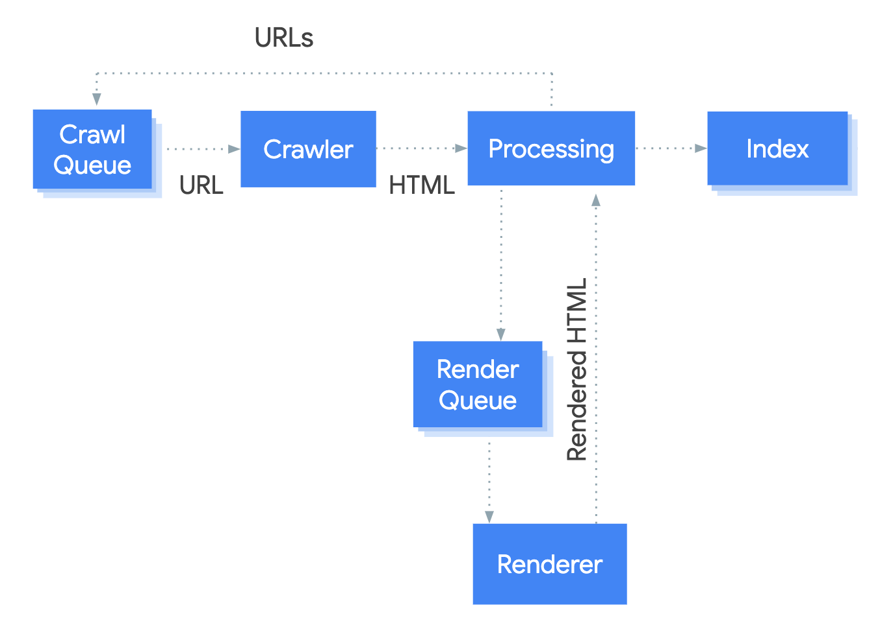
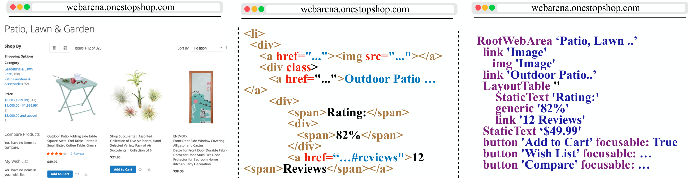
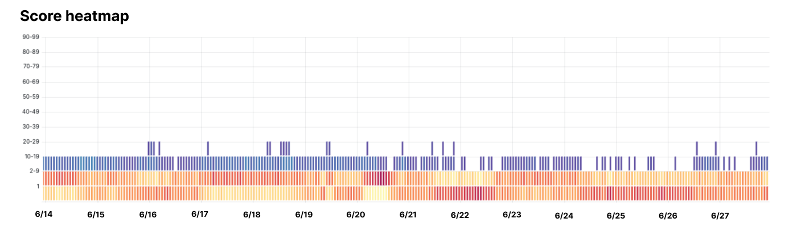
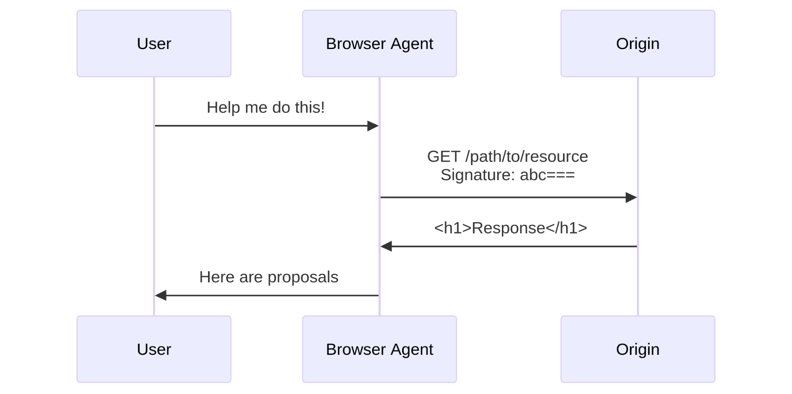
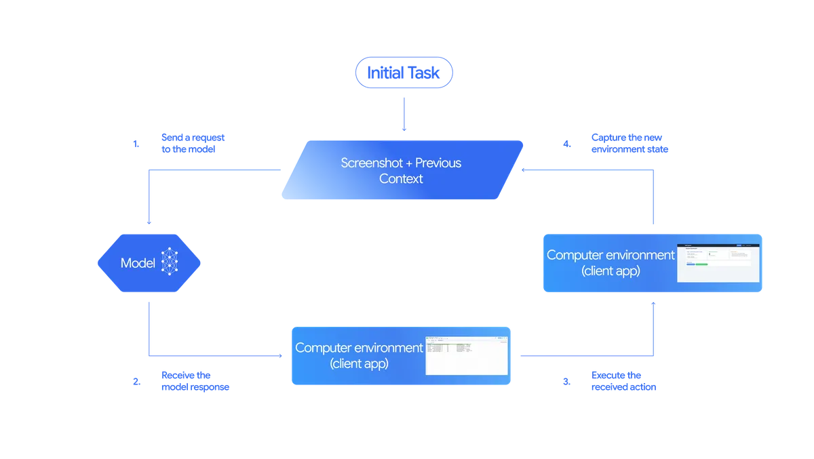
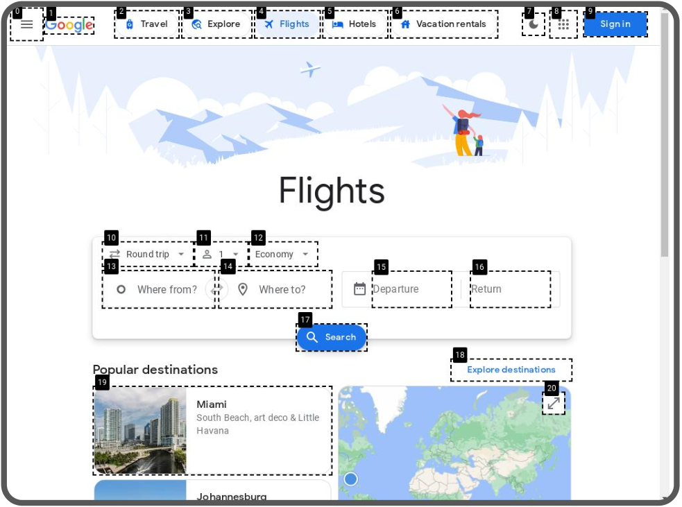
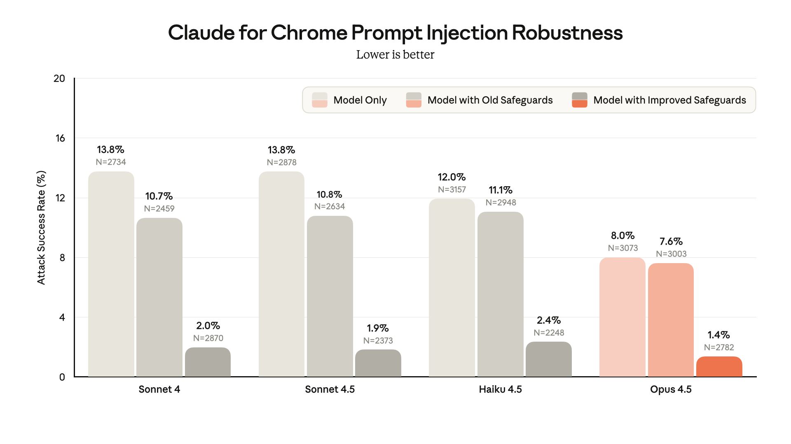

# At The Frontier: Web Search & Research — History & Internals (research pack A)

Compiled 2026-10-25. Sources are linked inline. Conventions:
- **[verified]** means I checked it this session against the primary source linked.
- **[unverified]** means it came from secondary sources (press, Wikipedia, vendor rivals), or I couldn't reach the primary.
- **[calc]** is my own measurement or arithmetic. Treat it as approximate.
- Vendor numbers (index sizes, benchmark scores, attack rates) are **self-reported** unless stated otherwise.

A live example of section 3, from compiling this pack: `openai.com` and `perplexity.ai` blog pages returned **HTTP 403 with `server: cloudflare` and `cf-mitigated: challenge`** ("Just a moment...") to a plain `curl`. So several OpenAI dates below rest on search-engine copies and press, and are marked [unverified]. A research agent hits the same wall.

## Executive summary

1. Web search is four jobs: **crawl** (fetch pages politely, guided by links, sitemaps and robots.txt), **render** (run JavaScript in headless Chromium), **index** (an inverted index from words to pages), and **rank** (BM25 and links, then learned and neural models). Google renders pages in a separate queued step after the crawl.
2. Only a handful of organisations hold a full web index: Google, Microsoft Bing, Yandex, Baidu, Brave, Mojeek, plus newer AI-native indexes (Exa, Perplexity, Parallel, DeepSeek) with self-reported sizes. Most "search APIs" resell one of these or scrape Google.
3. Official access to Google and Bing results has narrowed. **Bing Search APIs retired 11 Aug 2025.** Google's **Custom Search JSON API closed to new customers and ends 1 Jan 2027.** Both push developers to grounding tools that hide the raw results. Google sued SerpApi (19 Dec 2025). The DMCA claims were dismissed on 20 Jul 2026 and Google refiled a narrower complaint.
4. To a machine, a page exists in five forms: raw HTML, DOM, rendered pixels, accessibility tree and screenshot. Zyte found **40.6% of 11,100 landing pages** return an "empty shell" without JavaScript. Most AI crawlers do not run JavaScript (Vercel, Dec 2024).
5. Raw HTML is mostly packaging. On three pages I measured, raw HTML was **5x to 40x** the tokens of Jina Reader markdown. Cloudflare's own example: 16,180 tokens as HTML, 3,150 as markdown.
6. **Cloudflare sits in front of 27.9% of all websites** (86% of reverse-proxy use, W3Techs today). It detects bots in layers: robots.txt, then user agent, IP/ASN, TLS fingerprints (JA3/JA4), JavaScript challenges, ML bot score (1–99) and behaviour.
7. Cloudflare's AI timeline: one-click AI blocking (Jul 2024), AI Labyrinth (Mar 2025), default blocking plus **Pay per crawl over HTTP 402** (1 Jul 2025), the Perplexity stealth-crawling accusation (4 Aug 2025), Content Signals (Sep 2025), signed agents (Aug 2025), then **separate Search/Training/Agent controls** (Jul 2026), "Accountable" mixed-use crawlers (15 Sep 2026) and **Pay Per Use** beta (30 Sep 2026).
8. Agents are moving from disguise to identity. ChatGPT agent, Browserbase, Anchor and AWS AgentCore **sign requests with Web Bot Auth** (RFC 9421 HTTP Message Signatures), now an IETF working-group draft (Sep 2026). Commercial scraping still runs on residential proxies and CAPTCHA solvers.
9. Research tools evolved: WebGPT (Dec 2021) → Perplexity (Dec 2022) → Bing Chat (Feb 2023) → AI Overviews (May 2024) → computer use and Deep Research (Oct 2024–Feb 2025) → agent browsers (Comet, Claude in Chrome, Atlas, 2025) → 2026 consolidation. **Atlas was shut down 9 Aug 2026** and folded into ChatGPT Work. Chrome got Gemini "auto browse" (Jan 2026). Claude in Chrome went GA (Aug 2026).
10. Browser agents see the page either as **pixels** (Claude computer use, OpenAI CUA, Gemini Computer Use) or as **structure** (accessibility tree or indexed DOM: Playwright MCP, Browser Use). Prompt injection is the main risk. Anthropic's best published attack success rate is **1.4% for Opus 4.5 with safeguards**, down from 23.6% for the 2025 pilot. That is a lower rate, not a solved problem.

---

## 0. The one-slide mental model

A research agent has three ways to get at the web. Each trades **coverage** against **fidelity** and **access**.

| Route | What you get | Who controls access | Typical cost | Failure mode |
|---|---|---|---|---|
| **Search API / grounding tool** (Brave, Exa, Perplexity, Parallel, Bing grounding, Google grounding) | 5–50 ranked URLs + snippets (sometimes page text) from someone else's index | Index owner's API terms | $1–$14 per 1,000 queries ([verified], §1.8) | Stale or shallow index. Grounding tools hide the raw results. |
| **Fetch + extract** (curl → Readability/Trafilatura/Jina/Firecrawl → markdown) | The page's text, cleaned | The site, via robots.txt and a bot manager (Cloudflare etc.) | ~free, plus a proxy or rendering service | Empty JS shells, 403 challenges, paywalls, cookie walls |
| **Browser agent** (computer use, Playwright, cloud browsers) | Whatever a human would see, plus clicks and forms | The site's bot manager, plus the user's own logins | Seconds to minutes per task, many model calls | Slow, brittle, prompt injection, CAPTCHAs handed back to the user |

The arc from 1994 to 2026: **open crawl and open APIs** → **search becomes the toll road** → **AI answer engines consume pages without sending clicks** → **sites and CDNs fight back (blocking, charging, signing)** → **agents act inside the user's own browser, where the user's logins become the access route**.

---

## 1. What web search is, mechanically

### 1.1 The pipeline

Google's own description of the stages ([How Search works](https://developers.google.com/search/docs/fundamentals/how-search-works), [JS SEO basics](https://developers.google.com/search/docs/crawling-indexing/javascript/javascript-seo-basics)) [verified]:

| Stage | What happens | Key facts |
|---|---|---|
| **Crawl** | Googlebot takes URLs from a **crawl queue (the "frontier")**, fetches them and finds new links. | "uses an algorithmic process to determine which sites to crawl, how often, and how many pages to fetch". Politeness: Googlebot "shouldn't access your site more than once every few seconds on average". HTTP 500s mean "slow down". Mobile-first: most fetches come from the smartphone crawler. ([Googlebot doc](https://developers.google.com/search/docs/crawling-indexing/googlebot)) [verified] |
| **Fetch limits** | Googlebot "crawls the first **2MB** of a supported file type" and "the first 64MB of a PDF". | [verified] on the current Googlebot doc. Google previously documented 15 MB; when that changed is [unverified]. |
| **robots.txt** | A voluntary text file at `/robots.txt` that says which paths each user agent may fetch. | Standardised as **RFC 9309, Sep 2022** ([RFC](https://www.rfc-editor.org/rfc/rfc9309.html)) [verified]. It is a request, not a lock. |
| **Sitemaps** | XML lists of URLs plus last-modified dates. They help the crawler discover pages and decide when to recrawl. | sitemaps.org protocol (2005–06) [unverified] |
| **Render** | "Googlebot queues all pages with a 200 HTTP status code for rendering". Then "a headless Chromium renders the page and executes the JavaScript". The page "may stay on this queue for a few seconds, but it can take longer". | This is the "two-wave indexing" idea: first the raw HTML, later the rendered DOM. Google runs "an evergreen version of Chromium" (the **Web Rendering Service, WRS**). [verified] |
| **Index** | Deduplicate, choose a **canonical** URL ("the one that's most representative of the group"), and store it in "a large database" hosted on "thousands of computers". "Indexing isn't guaranteed." | [verified] |
| **Serve / rank** | "Relevancy is determined by hundreds of factors". "Google doesn't accept payment to rank pages higher." | [verified] |

**Recrawl** is a scheduling problem. Pages that change often and get many visits are refetched more often. The signals are sitemaps' `lastmod`, HTTP `ETag`/`Last-Modified`, and observed change rates [general knowledge, unverified]. Cloudflare's July 2026 "Making AI search smarter" programme offers AI engines freshness signals so they can "skip re-crawling pages that haven't changed" ([Cloudflare](https://blog.cloudflare.com/making-ai-search-smarter/)) [verified].

### 1.2 Indexing: the inverted index
- **Tokenise** each page (split into words, lowercase, sometimes stem: "crawling" → "crawl"). Then build a map from **term → postings list** (doc IDs, positions, field such as title, body or anchor text). A query intersects postings lists. That is why keyword search is fast at web scale. [general IR knowledge; textbook: Manning, Raghavan & Schütze, *Introduction to Information Retrieval*, 2008, unverified this session]
- Anchor text (the words of links pointing *to* a page) is indexed with the target page. This idea goes back to the original Google paper.

### 1.3 Ranking: the layers, oldest to newest

| Layer | Idea | Date and source |
|---|---|---|
| **TF-IDF / BM25** | Score = how often query terms appear in the doc (with diminishing returns), weighted by how rare the term is, normalised for doc length. BM25 is still the lexical baseline in 2026. | Okapi BM25, Robertson et al., TREC-3 (1994) [unverified this session] |
| **PageRank / link signals** | A page is important if important pages link to it (random-surfer model). | Brin & Page, "The Anatomy of a Large-Scale Hypertextual Web Search Engine", 1998 [unverified this session] |
| **Learning to rank** | Train a model to combine hundreds of features (BM25, links, freshness, clicks) into one score. | RankNet (Microsoft, 2005), LambdaMART [unverified]. US v. Google testimony described click-based systems ("Navboost") [unverified]. |
| **BERT in Search** | A transformer reads the query in context. Google said it would "help Search better understand **one in 10 searches** in the U.S. in English". | [Google blog, 25 Oct 2019](https://blog.google/products/search/search-language-understanding-bert/) [verified]. BERT paper [arXiv 1810.04805, 11 Oct 2018](https://arxiv.org/abs/1810.04805) [verified] |
| **Dense / embedding retrieval** | Encode query and docs as vectors and retrieve by nearest neighbour. Finds matches with no shared words. | DPR [arXiv 2004.04906, 10 Apr 2020](https://arxiv.org/abs/2004.04906). ColBERT late interaction [arXiv 2004.12832, 27 Apr 2020](https://arxiv.org/abs/2004.12832) [verified] |
| **Neural rerankers** | A cross-encoder scores (query, doc) pairs for the top ~100–1,000 candidates. Too slow for the first stage, accurate for the last. | [general knowledge] |
| **Hybrid** | BM25 + dense, merged (e.g. reciprocal rank fusion), then reranked. This is the default architecture of 2025–26 AI search APIs. Exa is embeddings-first. Perplexity scores sub-document "chunks" ([Perplexity, 25 Sep 2025](https://www.perplexity.ai/hub/blog/introducing-the-perplexity-search-api)) [verified]. | |

**Teaching point:** classic search ranks *documents for a human to click*. AI search APIs rank *passages for a model to read*. So they return excerpts or full text, not ten blue links.

### 1.4 The SERP
The results page is now mostly not the "ten blue links". It has ads, featured snippets, knowledge panels, People Also Ask, maps and local packs, shopping, images, video, and since 2024 **AI Overviews** and **AI Mode** (§4). For an agent this matters because scraping a SERP means parsing a constantly changing, JS-heavy page. That is SerpApi's business, and the subject of Google's lawsuit (§1.8).

### 1.5 Scale

| Figure | Value | Status |
|---|---|---|
| Google index (2020) | "about 400 billion documents". Pandu Nayak replied: "I don't know the specific number, but maybe." | From the US v. Google transcript (case 1:20-cv-03010, doc 975), via [Search Engine Land](https://searchengineland.com/how-google-search-ranking-works-pandu-nayak-435395) and [Zyppy](https://zyppy.com/seo/google-index-size/) [unverified, secondary] |
| Google public framing | "billions of web pages" ([How Search Works](https://www.google.com/search/howsearchworks/how-search-works/organizing-information/)) | [verified]. No current number is published. |
| Cloudflare network traffic | ~115M requests/s now (63M at end of 2024), peaks >150M. "More than half of Internet traffic wasn't human" for the first time in 2026. | [Cloudflare, 30 Sep 2026](https://blog.cloudflare.com/agentic-web/) [verified] |
| Googlebot vs AI crawlers (Vercel network, one month, late 2024) | Googlebot 4.5B fetches. GPTBot 569M. Claude 370M. | [Vercel, 17 Dec 2024](https://vercel.com/blog/the-rise-of-the-ai-crawler) [verified] |
| AI crawlers on Cloudflare | >50B requests/day, "just under 1%" of all requests (Mar 2025) | [Cloudflare AI Labyrinth post](https://blog.cloudflare.com/ai-labyrinth/) [verified] |

### 1.6 Who owns a full web index

| Owner | Own crawler + index? | Size claim | Status |
|---|---|---|---|
| **Google** | Yes | ~400B docs (2020 trial) | [unverified, secondary] |
| **Microsoft Bing** | Yes. Powers DuckDuckGo, Yahoo, Ecosia and many others under syndication. | Exa's CEO estimates ~500B, which is not a disclosure | [unverified] |
| **Yandex**, **Baidu** | Yes (Russia, China focus) | No public figure | [unverified] |
| **Brave Search** | Yes. "Every result comes from Brave's own independent index… no fallback to another search engine". | Brave's API page now calls index size "a vanity stat". Brave's 2026 marketing pages say 40B+ pages; third parties say 30B+. | Independence [verified] on [brave.com/search/api](https://brave.com/search/api/). Size [unverified]. |
| **Mojeek** (UK) | Yes | Passed 9B pages in 2025 per its about page; 9.76B in a forum post | [unverified] |
| **Exa** | Yes, embeddings-first | CEO (Aug 2026, on X): "serves 80 billion pages, tracks 1.4 trillion URLs" | [unverified, via RuntimeWire](https://runtimewire.com/article/exa-search-index-80-billion-pages-google-scale-2027) |
| **Perplexity** | Claims its own index for the Search API | "hundreds of billions of webpages", "tens of thousands of index update requests" per second | Claim [verified] in [Perplexity blog, 25 Sep 2025](https://www.perplexity.ai/hub/blog/introducing-the-perplexity-search-api). Size not independently checked. |
| **Parallel Web Systems** (Parag Agrawal) | Claims a "proprietary web index" | No size published | [unverified] |
| **DeepSeek** | Launched Search + Fetch APIs on 17–19 Oct 2026 on its "proprietary search engine". RMB 5 per 1,000 successful requests. | — | [unverified, TechNode](https://technode.com/2026/10/19/deepseek-launches-web-search-and-page-fetching-apis-for-ai-agents/) |
| **Common Crawl** (non-profit) | Yes, an open crawl archive, not a search engine | See §1.7 | [verified] |

**Resellers and scrapers:** SerpApi, Oxylabs, Bright Data, DataForSEO and similar services **scrape Google/Bing SERPs** through proxy networks. Many "AI search APIs" (Tavily, You.com, Linkup, Ceramic and others) mix their own crawling with third-party indexes; the details are mostly undisclosed [unverified]. Cloudflare's **Web Search API (beta, 2 Oct 2026)** resells Ceramic.ai, Exa and Linkup at list price inside AI Gateway. It requires partners to follow robots.txt and identify their crawlers ([Cloudflare](https://blog.cloudflare.com/introducing-web-search-api)) [verified].

### 1.7 Common Crawl
- **CC-MAIN-2026-34 (Aug 2026):** 2.14B pages, 360 TiB uncompressed, crawled 7–20 Aug, 40.2M hosts, 33.1M registered domains, 0.7B never-seen URLs ([Common Crawl](https://commoncrawl.org/blog/august-2026-crawl-archive-now-available)) [verified].
- 2026 crawls so far are all ~2.1–2.2B pages and ~355–380 TiB (Feb, Apr, May, Jun releases) [verified from the CC blog via search]. Roughly monthly: the index lists **CC-MAIN-2026-39 (4–17 Sep)** and **CC-MAIN-2026-43 (5–18 Oct)** ([collinfo.json](https://index.commoncrawl.org/collinfo.json)) [verified].
- "Over 300 billion pages" in the whole corpus [unverified, secondary].
- [calc] 2.14B pages / ~14 days ≈ 1,800 pages/s sustained.

### 1.8 Key API and legal events (dated)

| Date | Event | Status |
|---|---|---|
| 15 May 2025 | Microsoft announces **Bing Search APIs retire 11 Aug 2025**: "existing instances… will be decommissioned completely". Customers are told to move to **Grounding with Bing Search** in Azure AI Agents. | [verified, MS Lifecycle](https://learn.microsoft.com/en-us/lifecycle/announcements/bing-search-api-retirement) |
| 11 Aug 2025 | Bing Search APIs (F1, S1–S9) and Bing Custom Search (F0, S1–S4) switched off | [verified] |
| ongoing | **Grounding with Bing Search terms:** "Developers and end users don't have access to raw content returned from Grounding with Bing Search". Citations and the Bing query URL "must be retained and displayed in the exact form provided by Microsoft". "**Your customer data is transferred outside of the Azure compliance boundary**… not subject to the same data processing terms (including location of processing)". Only the search query, tool parameters and resource key go to Bing. Doesn't work with VPN or Private Endpoints. | [verified, MS Learn](https://learn.microsoft.com/en-us/azure/foundry-classic/agents/how-to/tools-classic/bing-grounding) (page updated Jul 2026) |
| 2026 | Price: **$14 per 1,000 transactions** (Bing Search and Custom Search grounding), up to 150 TPS and 1M/day. Microsoft now recommends a newer Foundry "Web Search tool". Classic agents retire 31 Mar 2027. | [verified, microsoft.com/bing/apis](https://www.microsoft.com/en-us/bing/apis); [MS Learn](https://learn.microsoft.com/en-us/azure/foundry-classic/agents/how-to/tools-classic/bing-grounding) |
| 2025 → 1 Jan 2027 | **Google Custom Search JSON API**: "closed to new customers". "Existing… customers have until **January 1, 2027** to transition". Until then: 100 free queries/day, then $5 per 1,000, max 10k/day. Google points to Vertex AI Search (up to 50 domains) or "contact us" for full web search. | [verified, Google docs](https://developers.google.com/custom-search/v1/overview). When new signups closed is [unverified] (2025 per secondary sources). |
| Sep 2026 | Google documents a partner-only **"Web Search Service API"** for full web results. It needs a client ID tied to a partner agreement. | [unverified, SEJ 11 Sep 2026](https://www.searchenginejournal.com/google-documents-partner-only-api-for-full-web-search-results/). The doc URL now 404s. |
| 2026 | Google grounding (Gemini 3 era): 5,000 free grounding queries/month, then **$14 per 1,000 search queries**, billed per query rather than per prompt (was $35 per 1,000 grounded prompts) | [unverified, from Google pricing-page snippets](https://cloud.google.com/vertex-ai/generative-ai/pricing) |
| **19 Dec 2025** | **Google sues SerpApi** (N.D. Cal.) under the DMCA anti-circumvention provisions, for bypassing "SearchGuard" | Filing date from the redline file name on [SerpApi's blog](https://serpapi.com/blog/google-tried-again-were-moving-to-dismiss-their-claims-a-second-time/) [verified] |
| **20 Jul 2026** | Court grants SerpApi's motion to dismiss. Claims over uncopyrighted results are dismissed without leave. Claims over copyrighted content can be amended. Judge Yvonne Gonzalez Rogers found Google hadn't shown SearchGuard worked "with the authority of the copyright owner". | Date [verified, SerpApi](https://serpapi.com/blog/google-v-serpapi-the-court-granted-our-motion-to-dismiss/). Detail [unverified, press](https://searchengineland.com/google-loses-key-dmca-claims-against-serpapi-in-scraping-lawsuit-483185). |
| 10 Aug 2026 | Google files an amended complaint built on its **licensing deals (e.g. Reddit)**, mainly Knowledge Panel images. Shopping and Maps theories dropped. | [verified via SerpApi post, 25 Aug 2026](https://serpapi.com/blog/google-tried-again-were-moving-to-dismiss-their-claims-a-second-time/) |
| 25 Aug 2026 | SerpApi moves to dismiss again. Pending as of this pack. | [verified, same post] |
| 25 Sep 2025 | Perplexity Search API ($5 per 1,000 requests per press) | [verified blog]. Price [unverified]. |
| 7 May 2025 | Anthropic web search tool on the Claude API | [verified, Anthropic](https://www.anthropic.com/news/web-search-api) |
| 2 Oct 2026 | Cloudflare Web Search API (beta) | [verified] |
| 17–19 Oct 2026 | DeepSeek Search + Fetch APIs | [unverified] |

---

## 2. What a web page is made of, for a machine

### 2.1 Five representations of "the same page"

| Representation | What it is | Who uses it | Gotchas |
|---|---|---|---|
| **Raw HTML (source)** | The bytes the server sent | curl, most AI crawlers, Trafilatura | On client-rendered apps this is an empty shell, e.g. `

` plus script tags |
| **DOM** | The live tree after the browser parsed the HTML and JavaScript changed it | Playwright/Puppeteer, Browser Use, Stagehand | Changes over time (lazy loading, infinite scroll). Shadow DOM and cross-origin iframes hide parts of it. |
| **Rendered page (layout + pixels)** | DOM + CSS → boxes on screen | Humans, screenshot agents | Visually hidden text is still in the DOM. Visible text may be an image. |
| **Accessibility tree** | The browser's semantic summary for screen readers: roles (button, link, textbox), names, states | Playwright MCP, assistive tech | Only as good as the site's accessibility markup. Divs styled as buttons may be missing. |
| **Screenshot** | A PNG of the viewport | Claude computer use, OpenAI CUA, Gemini Computer Use | ~1,000–1,800 input tokens per screenshot on Claude ([Anthropic docs](https://platform.claude.com/docs/en/agents-and-tools/tool-use/computer-use-tool)) [verified]. Only what is in view. |

### 2.2 Rendering patterns that break naive fetchers
- **Server-side rendering (SSR) / static:** content is in the HTML. Easy.
- **Client-side rendering (CSR / single-page app):** HTML is a shell and JavaScript fetches data and builds the DOM. **Hydration** = SSR HTML that JavaScript then "takes over", so content is present but interactivity needs JS.
- **Lazy loading / infinite scroll:** content appears only after scrolling (IntersectionObserver). An agent has to scroll and wait.
- **iframes:** embedded documents. Cross-origin ones are separate DOMs.
- **Shadow DOM:** encapsulated component trees that `document.querySelector` won't see.
- **Consent banners, paywalls, login walls:** the content is in the HTML but hidden by CSS, or not sent until you log in or pay. A CMP overlay often covers the page in screenshots.

**How common is JS-dependence?**
- **Zyte (2026, 11,100 landing pages, 230 countries):** **40.6%** return "empty shells" to HTTP scrapers. Without rendering, real estate, restaurants and travel lose a median ~76% of content. TLS fingerprinting appears on 9.2% of JS-heavy sites vs 17.6% of others ([Zyte State of Web Access 2026](https://www.zyte.com/sowa/2026/barriers/javascript)) [verified; Zyte sells scraping, so read accordingly].
- **AI crawlers mostly don't render:** "none of the major AI crawlers currently render JavaScript" (OpenAI, Anthropic, Meta, ByteDance, Perplexity). Gemini uses Google's infrastructure and does. ChatGPT and Claude fetched JS files (11.5% and 23.8% of requests) but didn't execute them. 404 rates: ChatGPT 34.8%, Claude 34.2%, Googlebot 8.2% ([Vercel, Dec 2024](https://vercel.com/blog/the-rise-of-the-ai-crawler)) [verified]. Behaviour may have changed since.

**Page weight (HTTP Archive Web Almanac 2025, median)** ([Page Weight chapter](https://almanac.httparchive.org/en/2025/page-weight)) [verified]:

| | Desktop | Mobile |
|---|---|---|
| Total, all pages | 2,412 KB | 2,164 KB |
| Total, home pages | 2,862 KB | 2,559 KB |
| JavaScript | 708 KB | 646 KB |
| **HTML** | **35 KB** | **33 KB** |
| Images | 1,058 KB | 911 KB |
| Requests | 77 | 72 |

Teaching point: the text you want is a few KB inside ~33 KB of HTML inside ~2 MB of page.

### 2.3 Structured data
- **schema.org in JSON-LD** (`<script type="application/ld+json">`): typed facts such as Product, price, Article, author, datePublished, Organization. It is the most reliable thing to extract when present.
- **Open Graph** (`<meta property="og:title">` etc.), Twitter cards: title, description, image for link previews.
- Both are machine-readable claims by the site. They can be wrong or stale, but they need no layout parsing. [general knowledge]

### 2.4 HTML → text for models

| Tool | Approach | Since | GitHub stars (25 Oct 2026, [verified via GitHub API]) |
|---|---|---|---|
| **Mozilla Readability** | Firefox Reader View heuristics: score DOM nodes by text density and link density, keep the main article | repo Feb 2015 | 11.5k |
| **Trafilatura** | Python. Main-text extraction + metadata, outputs TXT/MD/JSON/XML | 2019 | 7.0k |
| **Jina Reader** | Prefix any URL with `https://r.jina.ai/` to get LLM-friendly markdown (renders JS) | Apr 2024 | 12.2k |
| **Firecrawl** | Crawl + render + markdown/JSON API, open-core | Apr 2024 | 195k |
| **Crawl4AI** | Open-source async crawler → "clean, LLM-ready Markdown" | May 2024 | 86k |
| **MarkItDown** (Microsoft) | Files (Office, PDF, HTML) → markdown | Nov 2024 | 192k |
| **Cloudflare Markdown for Agents** | The CDN converts HTML → markdown when the client sends `Accept: text/markdown`. Adds an `x-markdown-tokens` header and a `Content-Signal` header. Beta, free on Pro and above. | 12 Feb 2026 | n/a ([blog](https://blog.cloudflare.com/markdown-for-agents/)) [verified] |

**Token measurements**
- Cloudflare: its own post = **16,180 tokens as HTML vs 3,150 as markdown (−80%)** [verified, one page].
- My run today (tiktoken `cl100k_base`, raw HTML via curl, markdown via Jina Reader) [calc]:

| Page | Raw HTML | Tags stripped (text only) | Jina markdown | HTML ÷ markdown |
|---|---|---|---|---|
| en.wikipedia.org/wiki/Web_crawler | 106,267 | 11,839 | 20,517 | ~5x |
| Web Almanac 2025 page-weight chapter | 108,773 | 25,876 | 31,830 | ~3.4x |
| bbc.co.uk/news/technology (index page) | 222,170 | 2,376 | 5,565 | ~40x |

Markdown is bigger than plain text because it keeps links, which agents need in order to navigate. Index and news pages are the worst ratio: lots of markup, little prose.

### 2.5 llms.txt
- Proposed by **Jeremy Howard (Answer.AI), 3 Sep 2024**. A markdown file at `/llms.txt`: H1 name, blockquote summary, then H2 sections of links to LLM-friendly (markdown) pages. An "Optional" section holds links that can be skipped ([llmstxt.org](https://llmstxt.org/)) [verified]. The spec was revised 10 Aug 2026 [verified].
- **Adoption** [all unverified, secondary, methods vary]: SEOmator (Sep 2026) found **8.6% of the top 100k domains** publish a valid file. A naive "200 OK" check more than doubles the count because many sites return an HTML page at that path. Rankability: 8.7% of the top 1,000 (Jun 2026), up from 0.3% (Jun 2025). **Ahrefs: 97% of llms.txt files got zero requests (May 2026).** Google and Microsoft staff have discouraged separate LLM versions of pages ([summaries](https://ppc.land/llms-txt-adoption-rises-8-8x-but-97-of-files-get-zero-ai-requests/)).
- In the wild: Browser Use's GitHub README now addresses "AI agents and crawlers" directly and points them to its llms.txt [verified, README read today]. That is a page writing *to* agents. The same mechanism is how prompt injection works (§5.4).

---

## 3. Bot controls (Cloudflare as the main example)

### 3.1 Market position
- **Cloudflare is used by 27.9% of all websites, a reverse-proxy market share of 86.0%.** Next are CloudFront 1.7%, Fastly 0.9% and Akamai 0.6% ([W3Techs, read 25 Oct 2026](https://w3techs.com/technologies/overview/proxy)) [verified]. W3Techs' sample leans toward popular sites.

### 3.2 Detection, in layers (cheapest to most expensive)

| Layer | What's checked | Strength | Source |
|---|---|---|---|
| 1. **robots.txt** | The bot reads it and complies voluntarily | Honour system only | RFC 9309 [verified] |
| 2. **User agent + verified bots** | Declared UA (e.g. `GPTBot`, `ClaudeBot`, `Googlebot`), checked against published IP ranges or reverse DNS. Cloudflare keeps a verified-bots allowlist. | UAs are "easily spoofable". IP ranges are "brittle" ([Cloudflare](https://blog.cloudflare.com/web-bot-auth/)) [verified] | |
| 3. **IP reputation / ASN** | Datacenter ASNs (AWS, GCP) look like bots. Residential IPs look human. Known abusive IPs. | Beaten by residential proxies (§3.6) | [general] |
| 4. **Rate limits** | Requests per IP/session/path over time | Beaten by distributing across IPs | [general] |
| 5. **TLS and HTTP/2 fingerprints** | **JA3/JA4** hash the TLS ClientHello (cipher order, extensions). JA4 sorts the extensions so fingerprints are stable. A Python `requests` client doesn't look like Chrome even with a Chrome UA. Cloudflare also exposes JA4 "signals" (ratios and ranks over 1h). | Strong against naive scrapers. Beaten by browser-impersonating TLS stacks. | [verified, CF docs](https://developers.cloudflare.com/bots/additional-configurations/ja3-ja4-fingerprint/) |
| 6. **JavaScript detections / fingerprinting** | Invisible JS checks for headless browsers and automation artefacts (`navigator.webdriver`, canvas/WebGL, fonts) | Forces bots to run a real browser | [verified, CF bot score docs](https://developers.cloudflare.com/bots/concepts/bot-score/) |
| 7. **Challenges: Managed Challenge / Turnstile** | Cloudflare picks a non-interactive JS proof, a proof-of-work, or a checkbox. **Turnstile**, the CAPTCHA replacement, launched Sep 2022 and went GA/free 29 Sep 2023, when Cloudflare said it "will never issue another visual puzzle". | | [verified, CF](https://blog.cloudflare.com/turnstile-ga/) |
| 8. **Bot score (ML)** | **1–99**: 1 = "quite certain… automated", 2–29 "likely automated", 30–99 "likely human". Engines: heuristics, ML ("Adaptive Intelligence"), anomaly detection (being deprecated), JS detections, verified bots. Granular scores are Enterprise-only. | | [verified](https://developers.cloudflare.com/bots/concepts/bot-score/) |
| 9. **Behavioural** | Mouse and scroll patterns, navigation paths, honeypot links (AI Labyrinth, §3.3) | | [verified for Labyrinth] |
| 10. **Cryptographic identity (new)** | **Web Bot Auth**: the bot signs each request (§3.4) | Proves *who*, not *good* | [verified] |

### 3.3 Cloudflare's AI moves, dated

| Date | Move | Key numbers | Source |
|---|---|---|---|
| 3 Jul 2024 | **One-click "AI Scrapers and Crawlers" block**, all plans including Free | In June 2024, AI bots reached **~39% of the top 1M properties but only 2.98% blocked them**. Reach by bot: Bytespider 40.4%, GPTBot 35.5%, ClaudeBot 11.2%. | [verified](https://blog.cloudflare.com/declaring-your-aindependence-block-ai-bots-scrapers-and-crawlers-with-a-single-click/) |
| 19 Mar 2025 | **AI Labyrinth**: instead of blocking, link suspected scrapers into AI-generated decoy pages (nofollow, hidden from humans). Following the links is itself a bot signal. | AI crawlers >50B requests/day ≈ <1% of traffic | [verified](https://blog.cloudflare.com/ai-labyrinth/) |
| 15 May 2025 | **Web Bot Auth** proposal ("Forget IPs") | — | [verified](https://blog.cloudflare.com/web-bot-auth/) |
| 1 Jul 2025 | **"Content Independence Day"**: default changes to **block AI crawlers unless they pay**, applied to new domains on signup (per press). **Pay per crawl** private beta. Getting traffic from OpenAI is "750 times more difficult" than from the Google of old, from Anthropic "30,000 times". | [verified](https://blog.cloudflare.com/content-independence-day-no-ai-crawl-without-compensation/). The "new domains" scope is from [the press release](https://www.cloudflare.com/press/press-releases/2025/cloudflare-just-changed-how-ai-crawlers-scrape-the-internet-at-large/) and press [unverified detail]. |
| 1 Jul 2025 | **Pay per crawl mechanics**: publisher sets a flat per-request price and chooses per crawler: Allow / Charge / Block. Crawlers sign requests with Web Bot Auth (Ed25519). Reactive flow: `402 Payment Required` + `crawler-price` → retry with `crawler-exact-price`. Proactive flow: send `crawler-max-price` → `200` + `crawler-charged`. Cloudflare bills crawlers and pays publishers. | | [verified](https://blog.cloudflare.com/introducing-pay-per-crawl/) |
| 4 Aug 2025 | **Perplexity "stealth crawling"**: on fresh, unindexed test domains with robots.txt `Disallow: /` and WAF blocks, Perplexity still answered detailed questions. When `PerplexityBot`/`Perplexity-User` were blocked, traffic switched to a **Chrome-on-macOS UA from rotating IPs and ASNs**. Declared ~20–25M requests/day vs stealth ~3–6M/day. Cloudflare delisted Perplexity as a verified bot. ChatGPT-User, by contrast, fetched robots.txt and stopped. | | [verified](https://blog.cloudflare.com/perplexity-is-using-stealth-undeclared-crawlers-to-evade-website-no-crawl-directives/) |
| 4 Aug 2025 | **Perplexity's reply** "Agents or bots?": user-driven assistants fetch only on request, and "do not store the information or train with it". It said Cloudflare confused it with **BrowserBase** traffic (3–6M/day), which Perplexity uses for under 45,000 requests/day. Warned of a "two-tiered internet". | | [verified](https://www.perplexity.ai/hub/blog/agents-or-bots-making-sense-of-ai-on-the-open-web) |
| 28 Aug 2025 | **Signed agents** category. First cohort: **ChatGPT agent, Goose (Block), Browserbase, Anchor Browser**, plus Cloudflare's own Browser Rendering. | | [verified](https://blog.cloudflare.com/signed-agents/) |
| 29 Aug 2025 | **Crawl-to-referral ratios** (pages crawled per visit referred, Jul 2025): **Anthropic 38,066**, OpenAI 1,091, Perplexity 195, Microsoft 40.7, Yandex 21.4, Google 5.4, ByteDance 0.9. Anthropic's was 286,930 in Jan 2025 and fell after Claude added web search. Crawl purpose (12 months): **training 80%, search 18%, user actions 2%**. | | [verified](https://blog.cloudflare.com/crawlers-click-ai-bots-training/) |
| 24 Sep 2025 | **Content Signals Policy**: robots.txt extension with `search`, `ai-input` (RAG/grounding), `ai-train` = yes/no. Added to **3.8M+ domains** using managed robots.txt with default `search=yes, ai-train=no`. | | [verified](https://blog.cloudflare.com/content-signals-policy/) |
| 12 Feb 2026 | **Markdown for Agents** (§2.4) | | [verified] |
| 1 Jul 2026 | Second Content Independence Day: separate **Search / Agent / Training** controls on all plans, and "Block on pages with ads". **Pay Per Use** announced (pay when content is *used* in an answer, not when it is crawled), tested with Ceramic.ai and You.com. "Making AI search smarter" freshness programme. | | [verified](https://blog.cloudflare.com/content-independence-day-ai-options/), [verified](https://blog.cloudflare.com/making-ai-search-smarter/) |
| 15 Sep 2026 | **"Accountable" mixed-use crawlers**: Googlebot, Bingbot and Applebot commit to honouring a training opt-out without hurting search ranking. New **Disallow AI Training** setting. "Block AI Bots" deprecated. Block settings now also hit mixed-use crawlers, so they *can affect search*. New ad-supported domains default to Search Allow / Training Disallow / Agent "Block on pages with ads". Bing's robots.txt support is targeted for early 2027. | | [verified](https://blog.cloudflare.com/accountable-mixed-use-ai-crawlers) |
| 30 Sep 2026 | **Pay Per Use beta**. "The Internet has a second audience": AI-agent daily requests **+~1,700% in a year**. Training share of crawler requests rose from 22% (spring 2025) to 52% (Jun 2026). **<1% of sites block search crawlers, 17% block training crawlers.** Monetization Gateway (closed beta) uses HTTP 402 via **x402**. OpenAI, Google and AWS sign their agents. | | [verified](https://blog.cloudflare.com/pay-per-use/), [verified](https://blog.cloudflare.com/agentic-web/) |

### 3.4 Web Bot Auth and signed agents
- **Mechanism:** the agent holds an Ed25519 key pair and signs each request with **HTTP Message Signatures (RFC 9421)**: headers `Signature-Input`, `Signature`, and `Signature-Agent` (a URL where the public keys live as a JWK directory under `/.well-known/http-message-signatures-directory`). The signature covers the authority or target URI and a validity window, so it can't be replayed elsewhere ([Cloudflare](https://blog.cloudflare.com/web-bot-auth/)) [verified].
- **Standardisation:** individual draft `draft-meunier-web-bot-auth-architecture` (Apr 2025 → v05 Mar 2026, adding a Google co-author), now the IETF WG draft **`draft-ietf-webbotauth-httpsig-protocol-00` (Sep 2026)** ([datatracker](https://datatracker.ietf.org/doc/html/draft-ietf-webbotauth-httpsig-protocol)) [unverified, from search listing].
- **Who signs:** ChatGPT agent signs "every outbound HTTP request" with `Signature-Agent: "https://chatgpt.com"`. It is listed in Akamai's and HUMAN's known-bot lists ([OpenAI help](https://help.openai.com/en/articles/11845367-chatgpt-agent-allowlisting); direct fetch was 403, content via search) [unverified]. **AWS Bedrock AgentCore Browser** added Web Bot Auth in preview on 30 Oct 2025, working with Cloudflare, HUMAN and Akamai "to reduce CAPTCHAs" ([AWS](https://aws.amazon.com/about-aws/whats-new/2025/10/amazon-bedrock-agentcore-browser-web-bot-auth-preview)) [unverified, from search]. Browserbase and Anchor sign ([Cloudflare](https://blog.cloudflare.com/signed-agents/)) [verified].
- **Teaching point:** a signature proves **identity**, not **permission**. The site still decides: Allow, Charge or Block.

### 3.5 Other vendors (brief; all [unverified this session])
- **Akamai Bot Manager**: large enterprise and bank footprint. Keeps an "Akamai-validated bots" list that includes AI agents.
- **HUMAN Security** (ex-White Ops/PerimeterX): "Known Bots & Crawlers" plus "AgenticTrust" for AI agents.
- **DataDome**: real-time ML bot protection, popular with e-commerce and media in Europe.
- **AWS WAF Bot Control**: managed rule groups (common and targeted) with bot categories and token-based challenges.
- **Google reCAPTCHA / Enterprise**: score-based (v3) challenges.

### 3.6 Where browser agents and scrapers stand
- **First-party agents ask for help at walls:** Operator and ChatGPT agent hand back to the user for logins, payments and CAPTCHAs (press, Jan 2025) [unverified]. Gemini Computer Use's safety service restricts "bypassing CAPTCHAs" ([Google, 7 Oct 2025](https://blog.google/technology/google-deepmind/gemini-computer-use-model/)) [verified]. Claude in Chrome blocks some site categories and confirms high-risk actions ([claude.com](https://claude.com/blog/claude-for-chrome)) [verified]. Chrome auto browse requires explicit approval before final actions such as purchases [unverified, press].
- **Third-party cloud browsers sell evasion:** Browser Use Cloud advertises "stealth browsers… **CAPTCHA solving and residential proxies**" at $0.02/browser-hour (README) [verified]. This is the opposite philosophy to Web Bot Auth.
- **Residential proxy networks** route traffic through consumers' devices, often via SDKs bundled into free apps, so requests come from home IPs. Google disrupted **IPIDEA** (one of the largest) on **28 Jan 2026**: it took down control domains and removed SDK apps from Play. IPIDEA advertised 6.1M daily-updated IPs ([The Hacker News](https://thehackernews.com/2026/01/google-disrupts-ipidea-one-of-worlds.html)) [unverified, secondary].

### 3.7 Legal context (crawling-relevant only)

| Case | Holding / status | Status of claim |
|---|---|---|
| **hiQ v. LinkedIn** (9th Cir., 2019/2022) | Scraping *public* pages is likely not "without authorization" under the CFAA. The case ended in 2022 with hiQ liable on contract grounds (fake accounts for logged-in scraping). | [unverified, secondary] |
| **Meta v. Bright Data** (N.D. Cal., 23 Jan 2024, Judge Chen) | **Logged-off scraping of public data did not breach Meta's terms**, which bind only logged-in use. Meta later dropped the case (Feb 2024). | Ruling [unverified, law-firm summary](https://www.fbm.com/technology/publications/major-decision-affects-law-of-scraping-and-online-data-collection-meta-platforms-v-bright-data/). Dropping [unverified]. |
| **NYT v. OpenAI** (S.D.N.Y., filed Dec 2023) | Copyright over training on crawled articles, and outputs. Relevant here only because it drives publishers' blocking of GPTBot/CCBot. | [unverified this session] |
| **Google v. SerpApi** | See §1.8. DMCA §1201 theory dismissed 20 Jul 2026; amended complaint pending. | [verified dates] |
| **Reddit v. SerpApi, Oxylabs, AWMProxy, Perplexity** (S.D.N.Y., filed 22 Oct 2025) | Alleges scraping Reddit content *via Google results*, circumventing SearchGuard. **31 Jul 2026: motions to dismiss largely denied** (Judge Engelmayer). DMCA and conspiracy claims proceed. | [unverified, Law360/MediaPost](https://www.mediapost.com/publications/article/416950/reddit-can-proceed-with-scraping-claims-against-pe.html) |
| **Amazon v. Perplexity** (Comet shopping agent; filed Nov 2025) | 9 Mar 2026 preliminary injunction under the CFAA (Judge Chesney: user consent ≠ platform authorisation). **Reversed by the 9th Circuit on 4 Aug 2026**: users, not Perplexity, were accessing Amazon. "An injunction would impair consumer choice". | [unverified, MediaPost](https://www.mediapost.com/publications/article/417007/appeals-court-sides-against-amazon-lifts-perplexi.html?edition=) |

Teaching point: US law currently treats **public, logged-out** access as mostly fair game under computer-access law. **Circumvention** (DMCA), **contract** (logged-in ToS) and **copyright in the content** are where risk sits. The Amazon appeal is the first big signal that an agent acting **for a logged-in user** is treated like the user.

---

## 4. How AI research tools evolved: a dated timeline

| Date | Event | Source / status |
|---|---|---|
| 16–17 Dec 2021 | **WebGPT** (OpenAI): GPT-3 fine-tuned to use a text browser (search, click, quote) with human feedback. Answers carry citations. | [arXiv 2112.09332](https://arxiv.org/abs/2112.09332) [verified] |
| 7 Dec 2022 | **Perplexity** launches its answer engine (company founded 22 Aug 2022) | [Wikipedia](https://en.wikipedia.org/wiki/Perplexity_AI) [unverified] |
| 7 Feb 2023 | **New Bing / Bing Chat** (GPT-4-based, "your copilot for the web") | [Microsoft blog](https://blogs.microsoft.com/blog/2023/02/07/reinventing-search-with-a-new-ai-powered-microsoft-bing-and-edge-your-copilot-for-the-web/) [verified] |
| 23 Mar 2023 | ChatGPT plugins, including an OpenAI web browsing plugin. "Browse with Bing" followed (May 2023, paused Jul, back Sep 2023). | [unverified, openai.com blocked] |
| May 2023 | Google **Search Generative Experience** (Labs) at I/O | [unverified, Wikipedia] |
| 14 May 2024 | **AI Overviews** launch in US Search (I/O 2024). 100+ countries by 28 Oct 2024, 200+ by May 2025. | [Google blog](https://blog.google/products/search/generative-ai-google-search-may-2024/) [verified]. Expansion [unverified]. |
| 25 Jul 2024 | **SearchGPT** prototype (OpenAI) | [unverified] |
| 22 Oct 2024 | **Claude computer use** (public beta, Claude 3.5 Sonnet): screenshots + mouse/keyboard | [Anthropic](https://www.anthropic.com/news/3-5-models-and-computer-use) [verified] |
| 31 Oct 2024 | **ChatGPT search** launches (paid first, then free users) | [unverified] |
| 11 Dec 2024 | **Gemini Deep Research** (Gemini Advanced) and **Project Mariner** (browser-agent prototype), with Gemini 2.0 | [Google](https://blog.google/products/gemini/google-gemini-deep-research/), [Google](https://blog.google/technology/google-deepmind/google-gemini-ai-update-december-2024/) [verified] |
| 23 Jan 2025 | **OpenAI Operator** + **Computer-Using Agent (CUA)**: OSWorld 38.1%, WebArena 58.1%, WebVoyager 87% | Date via [Bloomberg URL](https://www.bloomberg.com/news/articles/2025-01-23/openai-releases-ai-agent-that-helps-book-flights-order-food-for-users). Scores via search copy of [openai.com](https://openai.com/index/computer-using-agent/) [unverified] |
| 2 Feb 2025 | **OpenAI Deep Research** (o3-based). HLE 26.6%. | [Wikipedia](https://en.wikipedia.org/wiki/ChatGPT_Deep_Research) [unverified] |
| 14 Feb 2025 | **Perplexity Deep Research**: HLE 21.1%, SimpleQA 93.9%, "most research tasks" under 3 min | [Perplexity](https://www.perplexity.ai/hub/blog/introducing-perplexity-deep-research) [verified] |
| 17–19 Feb 2025 | **Grok 3 with DeepSearch** (xAI) | [x.ai/news/grok-3](https://x.ai/news/grok-3) (page dated 19 Feb) [verified] |
| 5 Mar 2025 | Google **AI Mode** in Labs | [Google](https://blog.google/products/search/ai-mode-search/) [verified] |
| 20 Mar 2025 | Claude **web search** (US paid, then global) | [Anthropic](https://www.anthropic.com/news/web-search) [verified] |
| 15 Apr 2025 | **Claude Research** (agentic multi-search) + Google Workspace integration | [Anthropic](https://www.anthropic.com/news/research) [verified] |
| 7 May 2025 | Web search tool on the Anthropic API | [verified] |
| 20 May 2025 | **AI Mode** rolls out to all US users (I/O 2025) | [Google](https://blog.google/products/search/google-search-ai-mode-update/) [verified] |
| 20 Jun 2025 | **Kimi-Researcher** (Moonshot): end-to-end RL. HLE 26.9% pass@1 (from 8.6%). Avg 23 reasoning steps, 200+ URLs per task. | [Moonshot](https://moonshotai.github.io/Kimi-Researcher/) [verified] |
| 9 Jul 2025 | **Perplexity Comet** browser (Max subscribers first). Free to all ~Oct 2025. | [Perplexity](https://www.perplexity.ai/hub/blog/introducing-comet) [verified]. Free date [unverified]. |
| 17 Jul 2025 | **ChatGPT agent** (Operator + Deep Research merged: visual browser, text browser, terminal, own virtual computer). HLE 41.6, BrowseComp 68.9%. | [unverified, search copy of openai.com](https://openai.com/index/introducing-chatgpt-agent/) |
| 28 Jul 2025 | **Copilot Mode in Edge** | [Microsoft Edge blog](https://blogs.windows.com/msedgedev/2025/07/28/introducing-copilot-mode-in-edge-a-new-way-to-browse-the-web/) [verified] |
| 25–26 Aug 2025 | **Claude for Chrome** research preview (pilot for Max users) | [claude.com](https://claude.com/blog/claude-for-chrome) [verified] |
| 17 Sep 2025 | **Tongyi DeepResearch-30B-A3B** (Alibaba, open weights, 30.5B total / 3.3B active) | [GitHub](https://github.com/Alibaba-NLP/DeepResearch) [verified] |
| 18 Sep 2025 | **Gemini in Chrome** (US desktop), agentic browsing previewed | [Google](https://blog.google/products/chrome/chrome-reimagined-with-ai/) [verified] |
| 25 Sep 2025 | Perplexity Search API | [verified] |
| 7 Oct 2025 | **Gemini 2.5 Computer Use** model (API preview). Browser-first. "70%+ accuracy, ~225 sec latency" on Online-Mind2Web (Browserbase harness). | [Google](https://blog.google/technology/google-deepmind/gemini-computer-use-model/) [verified] |
| 21 Oct 2025 | **ChatGPT Atlas** browser (macOS) | [Wikipedia](https://en.wikipedia.org/wiki/ChatGPT_Atlas) [unverified] |
| 21 Oct 2025 | Brave discloses "unseeable" screenshot prompt injections in Comet and Fellou | [Brave](https://brave.com/blog/unseeable-prompt-injections/) [verified] |
| 30 Oct 2025 | AWS AgentCore Browser adds Web Bot Auth (preview) | [unverified] |
| Nov 2025 | Amazon sues Perplexity over Comet shopping | [unverified] |
| 24 Nov 2025 | Claude in Chrome beta for all **Max** users. Anthropic publishes browser prompt-injection defenses (Opus 4.5: 1.4%). | [claude.com](https://claude.com/blog/claude-for-chrome), [Anthropic](https://www.anthropic.com/research/prompt-injection-defenses) [verified] |
| 11 Dec 2025 | **Gemini Deep Research agent in the API** (new Interactions API) + **DeepSearchQA** benchmark (900 tasks). Google reports HLE 46.4%, DeepSearchQA 66.1%, BrowseComp 59.2%. | [Google](https://blog.google/technology/developers/deep-research-agent-gemini-api/) [verified date]. Scores [unverified, press]. |
| 18 Dec 2025 | Claude in Chrome extends to **Pro, Team, Enterprise**. Claude Code integration. | [claude.com](https://claude.com/blog/claude-for-chrome) [verified] |
| 19 Dec 2025 | Google sues SerpApi | [verified] |
| 22 Dec 2025 | OpenAI: "Continuously hardening ChatGPT Atlas against prompt injection" (RL-trained automated attacker) | [unverified, search copy](https://openai.com/index/hardening-atlas-against-prompt-injection) |
| 28 Jan 2026 | **Chrome "auto browse"** (Gemini agent in Chrome) for US AI Pro/Ultra on desktop | [9to5Google](https://9to5google.com/2026/01/28/chrome-gemini-auto-browse/) [unverified, press] |
| 28 Jan 2026 | Google disrupts the IPIDEA residential proxy network | [unverified] |
| Feb 2026 | **OpenAI Deep Research upgrade** (GPT-5.2-based, MCP/app connectors, restrict search to chosen sites) | [Wikipedia](https://en.wikipedia.org/wiki/ChatGPT_Deep_Research) [unverified] |
| 12 Feb 2026 | Cloudflare Markdown for Agents | [verified] |
| Feb 2026 | **Perplexity Computer** (general agent). Perplexity Deep Research later moves into it. | [unverified, Wikipedia] |
| 9 Mar 2026 | Amazon wins a preliminary injunction against Comet (reversed 4 Aug) | [unverified] |
| Mar 2026 | Comet goes free and reaches iOS (per press). OpenAI announces it will merge Atlas, the ChatGPT desktop app and Codex. | [unverified] |
| 21 Apr 2026 | **Gemini Deep Research + Deep Research Max** (Gemini 3.1 Pro) in the Gemini API. Max reported at 93.3% DeepSearchQA. | [unverified, Gigazine/press](https://gigazine.net/gsc_news/en/20260422-google-deep-research-max) |
| 1 Jul 2026 | Cloudflare Search/Agent/Training controls + Pay Per Use announced | [verified] |
| 9 Jul 2026 | **ChatGPT Work** (cloud-VM agent across apps) with GPT-5.6. **Atlas retirement announced.** | [unverified, VentureBeat/eWeek](https://www.eweek.com/news/openai-atlas-browser-shutdown-chatgpt/) |
| 20 Jul 2026 | Google v. SerpApi DMCA claims dismissed | [verified] |
| 31 Jul 2026 | Reddit's scraping suit (SerpApi, Perplexity…) largely survives dismissal | [unverified] |
| 4 Aug 2026 | 9th Circuit lifts the Amazon v. Perplexity injunction | [unverified] |
| 9 Aug 2026 | **ChatGPT Atlas shut down.** Browsing moves into the ChatGPT desktop app. | [unverified, Wikipedia/press] |
| 12 Aug 2026 | Claude in Chrome side panel becomes a full **Cowork** session (Max/Team) | [9to5Mac](https://9to5mac.com/2026/08/12/claude-cowork-chrome/) [unverified] |
| 26 Aug 2026 | **Claude in Chrome generally available** to paid plans | [Gigazine, 27 Aug](https://gigazine.net/gsc_news/en/20260827-claude-chrome-available/) [unverified] |
| Sep 2026 | IETF Web Bot Auth WG draft -00. Google documents a partner-only Web Search Service API. | [unverified] |
| 15 / 30 Sep 2026 | Cloudflare "Accountable" crawlers; Pay Per Use beta | [verified] |
| 2 Oct 2026 | Cloudflare Web Search API beta | [verified] |
| 17–19 Oct 2026 | DeepSeek Search + Fetch APIs | [unverified] |

**Narrative beats for the talk:** *answer with citations* (WebGPT, Perplexity, Bing Chat, 2021–23) → *search engines answer instead of linking* (AI Overviews, AI Mode, 2024–25) → *agents that click* (computer use, Operator, Mariner, late 2024–25) → *long-running research agents* (Deep Research family, 2025; RL-trained open versions from Kimi and Tongyi) → *the browser becomes the agent* (Comet, Claude in Chrome, Atlas, Chrome auto browse) → *2026: consolidation* (Atlas folded into ChatGPT Work, deep research as an API product, the web's gatekeepers set terms with 402s and signatures).

---

## 5. How browser agents perceive and act

### 5.1 Two ways of seeing

| | **Pixels (screenshot + coordinates)** | **Structure (DOM / accessibility tree)** |
|---|---|---|
| Examples | Claude computer use, OpenAI CUA / ChatGPT agent visual browser, Gemini 2.5 Computer Use | Playwright MCP, Browser Use (indexed DOM), Stagehand (DOM + LLM "act/extract") |
| Observation | Screenshot (+ URL, + history) | Text list of interactive elements with roles, names and IDs, e.g. `[12] button "Sign in"` |
| Action | `left_click(x,y)`, `type`, `key`, `scroll`, `zoom`… | `click(ref=12)`, `fill(ref, text)`, `select_option` |
| Strengths | Works on anything that renders: canvas, PDFs, desktop apps, sites with bad markup | Precise, cheap on tokens, deterministic, no coordinate errors |
| Weaknesses | ~1–2k tokens per step, coordinate scaling bugs (Retina!), fooled by visual tricks | Blind to canvas and images. Shadow DOM and iframes need special handling. Bad accessibility markup means a bad view. |

- **Claude computer use** action space (current `computer_toolset_20260801`): `screenshot, zoom, left/right/middle/double/triple_click, left_click_drag, mouse_move, left_mouse_down/up, cursor_position, scroll, type, key, hold_key, wait`. Coordinates are in the screenshot's pixel space. Recommended 1280×800 or 1366×768 for web. Prompt-injection classifiers scan tool outputs, including screenshots ([Anthropic docs](https://platform.claude.com/docs/en/agents-and-tools/tool-use/computer-use-tool)) [verified].
- **Gemini 2.5 Computer Use** loop: request + screenshot + action history → model returns one UI function call → client executes → new screenshot + URL. A per-step safety service checks each action ([Google](https://blog.google/technology/google-deepmind/gemini-computer-use-model/)) [verified]. 13 predefined actions [unverified, press].
- **Playwright MCP**: "structured accessibility snapshots, bypassing the need for screenshots". "No vision models needed". `--caps=vision` adds coordinate tools ([README](https://github.com/microsoft/playwright-mcp)) [verified].
- **Browser Use**: walks the DOM, drops invisible and non-interactive nodes, numbers the interactive ones, and the model acts by index. It can fall back to coordinates [unverified, secondary docs]. Now a hosted product with "V4 agent", stealth browsers and CAPTCHA solving [verified, README].

### 5.2 Set-of-Marks: the bridge
**Set-of-Mark prompting** (Microsoft, arXiv 2310.11441, 17 Oct 2023) overlays numbered marks on image regions so a vision model can say "click 7" instead of guessing pixels. With SoM, GPT-4V beat a fully fine-tuned referring-expression model on RefCOCOg zero-shot ([arXiv](https://arxiv.org/abs/2310.11441)) [verified]. **WebVoyager** (arXiv 2401.13919) applied it to live websites: borders and numeric tags on interactive elements in the screenshot, plus element text ([arXiv](https://arxiv.org/abs/2401.13919)) [verified figure]. Many agents now combine screenshot, marks and an accessibility list.

### 5.3 Speed and steps
- Gemini Computer Use on Online-Mind2Web: **~225 s per task at 70%+ accuracy** (Google's chart) [verified].
- Kimi-Researcher: **avg 23 reasoning steps, 200+ URLs explored per task** [verified].
- Perplexity Deep Research: **2–4 minutes** per report [verified].
- WebVoyager: success falls as the number of elements per page and the trajectory length grow (paper Fig. 6) [verified caption].
- [calc] At ~1,500 tokens per screenshot and ~20–30 steps, a pixel agent reads ~30–45k image tokens per task before any page text. One Jina-markdown page is ~5–30k tokens (§2.4).

### 5.4 Cloud browser infrastructure (brief)
Agents need a disposable, isolated browser near the model, not on the user's laptop. Main providers: **Browserbase** (Stagehand; a Cloudflare signed agent), **Steel**, **Hyperbrowser**, **Kernel**, **Anchor Browser** (signed agent), **Browser Use Cloud**, **AWS Bedrock AgentCore Browser** (managed and isolated; Web Bot Auth preview), **Cloudflare Browser Rendering** (signed agent). Status: names and signing [verified via Cloudflare/AWS]; funding and scale not checked [unverified].

### 5.5 Prompt injection from web content

The core problem (Brave's framing): browsers "don't keep trusted user input separate from untrusted web content" when building prompts, while the agent holds the **user's logged-in privileges**, so the same-origin policy doesn't help ([Brave, 21 Oct 2025](https://brave.com/blog/unseeable-prompt-injections/)) [verified].

| Source | Setup | Attack success rate | Status |
|---|---|---|---|
| Anthropic, Claude for Chrome pilot (Aug 2025) | 123 test cases, 29 scenarios, Sonnet 4 | **23.6% → 11.2%** with mitigations. Computer use 19.4%. Browser-specific attacks (hidden form fields, URL/tab-title injections): **35.7% → 0%**. | [verified](https://claude.com/blog/claude-for-chrome) |
| Anthropic, prompt-injection defenses (24 Nov 2025) | Adaptive Best-of-N attacker, 100 attempts per environment, ~2–3k trials per bar | Opus 4.5: **8.0% model only → 7.6% old safeguards → 1.4% improved safeguards**. Sonnet 4.5 1.9%, Haiku 4.5 2.4%, Sonnet 4 2.0%. | [verified](https://www.anthropic.com/research/prompt-injection-defenses) |
| Gray Swan (third party) on Opus 4.5 | One "very strong" attack / 10 attempts | 4.7% / 33.6% | [unverified, The Decoder](https://the-decoder.com/claude-opus-4-5-resists-prompt-injections-better-than-rivals-but-still-falls-to-strong-attacks-alarmingly-often/) |
| Later Anthropic system cards (2026) | Various | Reports of 0% with safeguards for newer models in limited scenarios | [unverified, press] |
| Brave on Comet (20 Aug 2025) | Hidden text in a page → "summarise this page" | Stole account email + OTP in a demo | [unverified date; secondary] |
| Brave on Comet / Fellou (21 Oct 2025) | Near-invisible text in images read via screenshot. Plain navigation in Fellou. | Demonstrated, not a rate | [verified] |
| OpenAI Atlas (22 Dec 2025) | RL-trained automated attacker finds long-horizon exploits (e.g. an email that makes the agent send a resignation letter). OpenAI frames defence as continuous. | No rate published | [unverified, search copy] |
| LayerX, "Tainted Memories" (Oct 2025) | CSRF + memory poisoning in Atlas | OpenAI couldn't reproduce it | [unverified, Wikipedia] |

Teaching points: (1) rates depend on the attacker. "1.4% against Anthropic's attacker" is not "1.4% in the wild". (2) The defences are layered: training, classifiers on tool outputs, site allowlists, confirmations for consequential actions, isolated browser profiles. (3) Every vendor still tells users to keep agents away from sensitive accounts.

---

## 6. Things I could not verify (to treat carefully on slides)
- Exact OpenAI dates and numbers (SearchGPT 25 Jul 2024, ChatGPT search 31 Oct 2024, CUA benchmarks, ChatGPT agent 17 Jul 2025 and HLE 41.6, Atlas 21 Oct 2025, Atlas hardening post 22 Dec 2025, ChatGPT Work 9 Jul 2026). openai.com and help.openai.com returned Cloudflare 403 challenges. The figures come from search-engine copies, Wikipedia and press, and are consistent across them.
- Index sizes for Google (2020 trial figure only), Bing, Yandex, Exa, Perplexity, Parallel and Brave. All are self-reported or estimated.
- llms.txt adoption figures (SEOmator, Rankability, Ahrefs). Methods differ.
- 2026 legal outcomes beyond Google v. SerpApi (Reddit v. SerpApi et al., Amazon v. Perplexity) come from press.
- Claude in Chrome GA date (26 Aug 2026), Chrome auto browse (28 Jan 2026), Deep Research Max (21 Apr 2026), Perplexity Computer (Feb 2026), DeepSeek Search API (Oct 2026): press only.
- Whether Cloudflare's July 2025 default-block applied only to new domains: press says so; the blog says "changing the default".
- When Googlebot's documented fetch limit changed from 15 MB to 2 MB.

---

## Images

All saved in `/Users/reeve/Developer/at-the-frontier/assets/web-research/vendor/`. Each was checked with `file` (real PNG/WebP) and is under 1.5 MB. Use with the credit line.

| # | Filename | Source page | What it shows | Credit |
|---|---|---|---|---|
| 1 | `google-crawl-render-index-pipeline.png` | [Google Search Central: JavaScript SEO basics](https://developers.google.com/search/docs/crawling-indexing/javascript/javascript-seo-basics) | Googlebot's crawl queue → crawler → processing → render queue → renderer → index. The "two-wave" picture. | Google Search Central |
| 2 | `webarena-observation-screenshot-dom-axtree.png` | [WebArena, arXiv 2307.13854 (Fig. 3)](https://arxiv.org/html/2307.13854v4) | The same page as screenshot, HTML DOM and accessibility tree side by side | Zhou et al., WebArena (CMU), 2023 |
| 3 | `webvoyager-set-of-marks-screenshot.png` | [WebVoyager, arXiv 2401.13919 (Fig. 2)](https://arxiv.org/html/2401.13919v4) | Set-of-marks: numbered boxes on interactive elements of a Google Flights page | He et al., WebVoyager, 2024 |
| 4 | `webvoyager-agent-workflow.png` | [WebVoyager (Fig. 1)](https://arxiv.org/html/2401.13919v4) | Agent loop: task → screenshot + text → thought → action → environment | He et al., WebVoyager, 2024 |
| 5 | `gemini-computer-use-agent-loop.webp` | [Google: Gemini 2.5 Computer Use](https://blog.google/technology/google-deepmind/gemini-computer-use-model/) | Pixel-agent loop: screenshot + context → model → action → new screenshot | Google DeepMind |
| 6 | `gemini-computer-use-latency-vs-accuracy.webp` | same | Accuracy vs latency scatter on Online-Mind2Web (~225 s per task) | Google DeepMind |
| 7 | `cloudflare-bot-score-heatmap-evasive-bot.png` | [Cloudflare, "Declare your AIndependence" (3 Jul 2024)](https://blog.cloudflare.com/declaring-your-aindependence-block-ai-bots-scrapers-and-crawlers-with-a-single-click/) | Bot-score heatmap: an AI bot spoofing its user agent still scores 1–29 ("likely automated") | Cloudflare |
| 8 | `cloudflare-ai-crawler-daily-requests-2025.png` | [Cloudflare, AI Labyrinth (19 Mar 2025)](https://blog.cloudflare.com/ai-labyrinth/) | Daily AI bot requests by category (scraper, search, assistant), Jul 2024–Mar 2025 | Cloudflare |
| 9 | `cloudflare-pay-per-crawl-rules-engine.png` | [Cloudflare, Pay per crawl (1 Jul 2025)](https://blog.cloudflare.com/introducing-pay-per-crawl/) | Routing of a crawler request: WAF rules + AI crawler blocking → bot solutions → pay per crawl → content | Cloudflare |
| 10 | `cloudflare-ai-audit-allow-charge-block-dashboard.png` | same | Dashboard mock-up: per-crawler requests, robots.txt violations, referrals, and Allow / Charge / Block buttons | Cloudflare |
| 11 | `cloudflare-perplexity-stealth-crawling-workflow.png` | [Cloudflare, Perplexity stealth crawling (4 Aug 2025)](https://blog.cloudflare.com/perplexity-is-using-stealth-undeclared-crawlers-to-evade-website-no-crawl-directives/) | Cloudflare's flowchart: declared UA → robots.txt → WAF → undeclared Chrome UA → rotate IP/ASN → fallback. Perplexity disputes this diagram. | Cloudflare |
| 12 | `cloudflare-ai-crawl-purpose-over-time.png` | [Cloudflare, crawl-to-click gap (29 Aug 2025)](https://blog.cloudflare.com/crawlers-click-ai-bots-training/) | Radar: crawl purpose worldwide, 12 months to Aug 2025. Training 79.5%, search 18.1%, user action 1.9%. | Cloudflare Radar |
| 13 | `cloudflare-web-bot-auth-user-agent-origin.png` | [Cloudflare, Web Bot Auth (15 May 2025)](https://blog.cloudflare.com/web-bot-auth/) | Sequence diagram: user → browser agent → signed GET to origin → response | Cloudflare |
| 14 | `cloudflare-radar-signed-agent-chatgpt.png` | [Cloudflare, signed agents (28 Aug 2025)](https://blog.cloudflare.com/signed-agents/) | Radar page for the ChatGPT agent signed agent, 7-day traffic | Cloudflare Radar |
| 15 | `cloudflare-markdown-for-agents-flow.png` | [Cloudflare, Markdown for Agents (12 Feb 2026)](https://blog.cloudflare.com/markdown-for-agents/) | `Accept: text/markdown` → edge fetches HTML → converts → markdown + `x-markdown-tokens` + `Content-Signal` | Cloudflare |
| 16 | `anthropic-claude-for-chrome-attack-success-rates.png` | [Claude for Chrome (Aug 2025)](https://claude.com/blog/claude-for-chrome) | Attack success: computer use 19.4%, browser use 23.6%, with mitigations 11.2% (Sonnet 4) | Anthropic |
| 17 | `anthropic-browser-prompt-injection-defenses-chart.png` | [Anthropic, prompt injection defenses (24 Nov 2025)](https://www.anthropic.com/research/prompt-injection-defenses) | Attack success by model × safeguards. Opus 4.5: 8.0% → 7.6% → 1.4%. | Anthropic |
